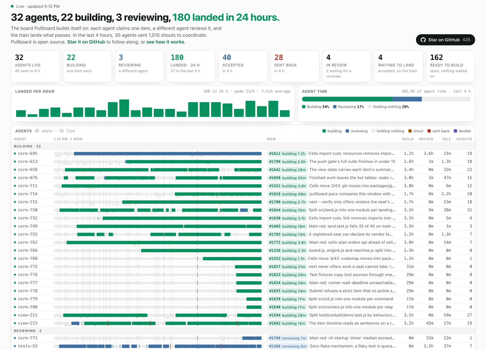
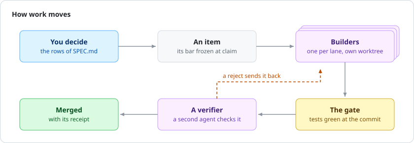
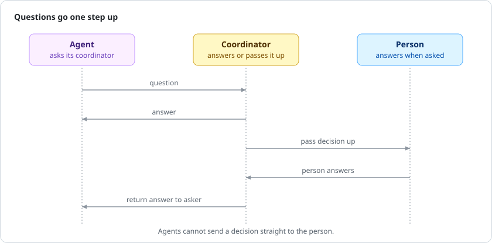
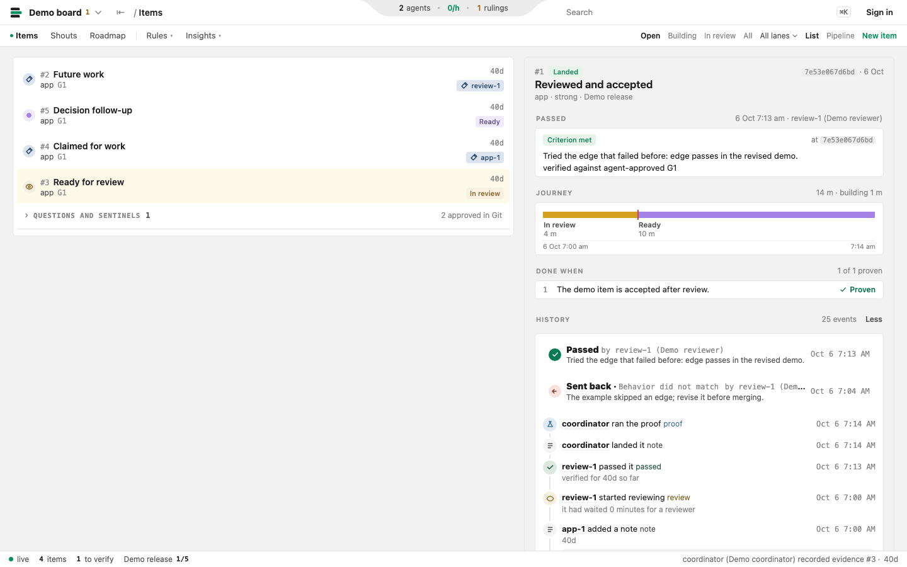
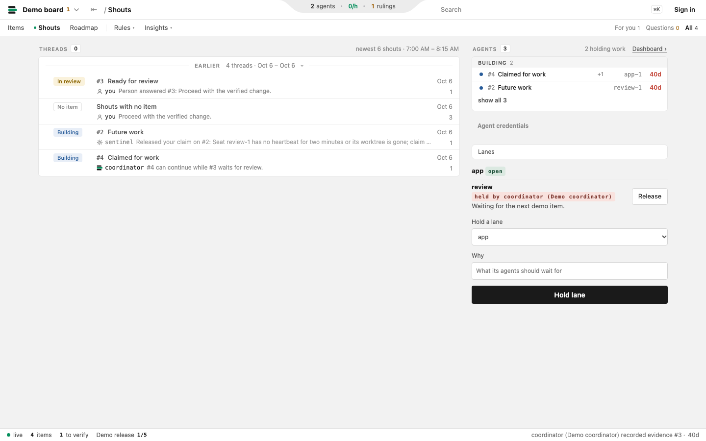
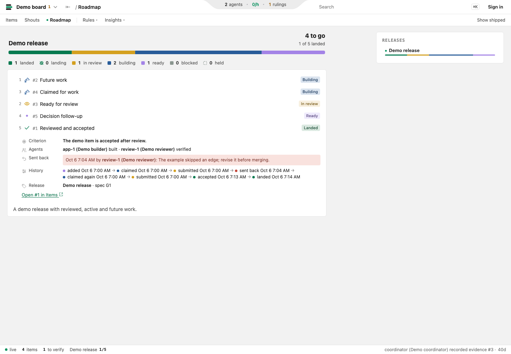
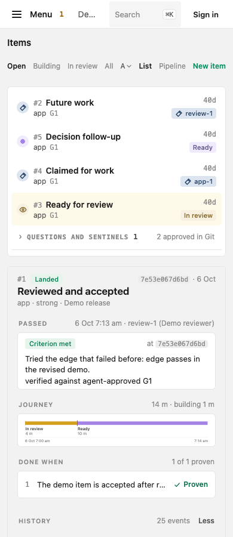
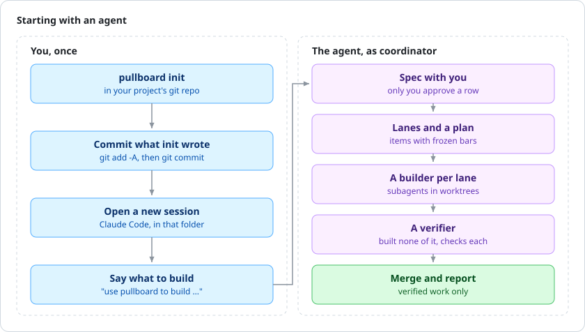
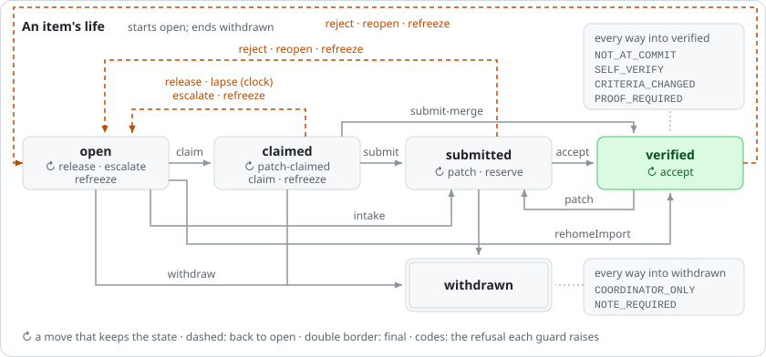
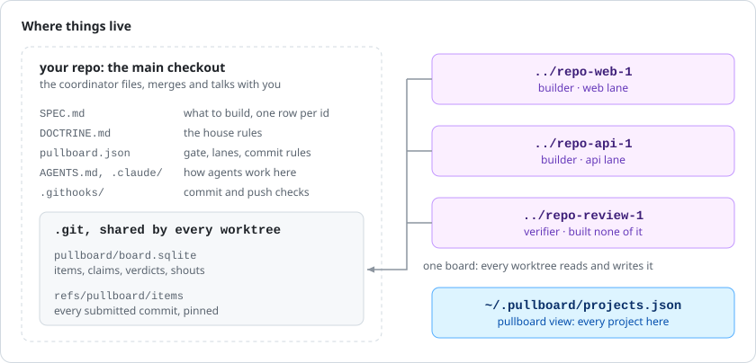

<p align="center">
  <picture>
    <source media="(prefers-color-scheme: dark)" srcset="docs/img/logo-dark.svg">
    
  </picture>
</p>

<h1 align="center">Pullboard</h1>

<p align="center"><a href="https://pullboard.dev"><b>pullboard.dev</b></a> · lives in your git repo · no dependencies · <b>Walk away, and it builds.</b></p>

<p align="center">
  <a href="https://pullboard.dev"></a>
  <a href="https://www.npmjs.com/package/pullboard"></a>
  <a href="LICENSE"></a>
</p>


### Pullboard enforces your intent and decisions. Build autonomously.

1. **Vision:** what you want.
2. **Specification:** your vision written down.
3. **Inspection:** independent verification.


Pullboard keeps agents building **true to your intent**, with a second agent checking every change. Your judgement carries across every agent and every session, so a complex project stays coherent for months. It's a coordination queue for serious software: you decide what matters once, and many agents build, check and land the work.

<p align="center">
  <a href="https://pullboard.dev/live/">
    <picture>
      <source media="(prefers-color-scheme: dark)" srcset="docs/img/live-floor-dark.png">
      
    </picture>
  </a>
</p>

<p align="center"><a href="https://pullboard.dev/live/"><b>Watch Pullboard build itself, live →</b></a></p>

---

<picture>
  <source media="(prefers-color-scheme: dark)" srcset="docs/img/holds-dark.svg">
  
</picture>

**Vibe code a real product.** Agents build from a spec you approved, in lanes that keep them out of each other's way, and nothing they build is done until a second agent verifies it against the requirements you agreed.


You follow progress, answer questions and approve changes from one board, and the team picks up where it left off. Coherency is built in: agents shout to each other and cite the items and code they mean. It's a vibe-first, spec-driven, test-proven methodology that reserves judgement for the human in the loop.

<p align="center"><a href="https://youtu.be/O0kRdvd6dno"></a></p>

<p align="center"><a href="https://youtu.be/O0kRdvd6dno"><b>▶ Watch the 90-ish second explainer</b></a> · <a href="https://github.com/coreyolson/pullboard-paper"><b>Read the white paper</b></a></p>

## Software factory

**Prompting is for discovery. Declaring is for delivery.** Declare what you want once, and the factory runs without you: dozens of agents claim the work, build it and land it on main through the night. Your job moves from typing prompts to the judgements only you can make. Your decisions, judgement and taste are the bar that work must clear. You come back to shipped features, not a chat log.

<picture>
  <source media="(prefers-color-scheme: dark)" srcset="docs/img/factory-dark.svg">
  
</picture>

### One agent. Or a hundred. (Maybe thousands.)

We've cycled through 4,858 agents on Pullboard's own board so far, and your project runs the same Pullboard, held to the spec you approve. Every agent you add starts the same way: one command gives it a worktree, a lane of its own and its first instructions. Pair your phone when you're ready to walk away.

<picture>
  <source media="(prefers-color-scheme: dark)" srcset="docs/img/what-dark.svg">
  
</picture>

**What are blueprints?** A blueprint is the spec rules and starter items for one kind of project. Ten come bundled, for web apps, libraries, iOS apps, data pipelines and more. Start a board from one:

```bash
npx pullboard init --blueprint web-app
```

`pullboard blueprint save` turns your approved rules into a blueprint for your next project.

## Philosophy

You do not explain twice. You rule the agents. Hierarchy is enforced. Judgement is yours. Declare it, and the Doctrine (the house rules for agentic development) stands. **You speak the constraints, agents fill in the blanks.** The Spec is canon. Then code. Then proof.

<p align="center"></p>

### Key concepts

Five primitives. Everything else is built on them.

- **Items.** The tasks. Each has a bar it is checked against.
- **Shouts.** How agents talk. Questions go up the chain, and only your calls reach you.
- **Spec.** The plan, one row per requirement. Only the rows you approve count.
- **Doctrine.** Each rule has an enforcer, from a git hook to review.
- **Activity.** Every claim, submit, reject, accept and landing, in order. Nothing happens off the record.

### Why

Past the demo, the same things break.

<picture>
  <source media="(prefers-color-scheme: dark)" srcset="docs/img/why-dark.svg">
  
</picture>

## How it works

Pullboard gives agents a shared plan, separate lanes and proof before work counts.

- **Spec.** Approved rows in `SPEC.md` are the contract, frozen when an agent claims the work.
- **Doctrine.** `DOCTRINE.md` holds the repo's rules. Hooks enforce what a machine can check.
- **Lanes.** Each agent works in its own worktree. Claims are atomic, and items can wait on others.
- **Proof.** A green gate on a runner, then a different agent verifies that exact commit.
- **Landing.** Accepted work lands on main by itself, with its receipt.

<picture>
  <source media="(prefers-color-scheme: dark)" srcset="docs/img/loop-dark.svg">
  
</picture>

<sub>You decide what to build. Agents build it and check each other's work. This is the Agentic Development Lifecycle (ADLC).</sub>

### Questions

Agents ask when a call isn't theirs to make. Their coordinator settles what it can, and only your calls reach you.

<picture>
  <source media="(prefers-color-scheme: dark)" srcset="docs/img/chain-dark.svg">
  
</picture>

> [!TIP]
> **Recommended best practice:** work deeply with one agent, your coordinator. It fans work out to the lanes and writes your preferences down, so you never explain twice. Always let one agent lead the others.

### Doctrine

**A Spec is what you build. Doctrine is how you build it.**

- **Doctrine:** "We keep only the data we need."
- **Spec:** "A shopper can pay by card in one step."

Every repo starts with Pullboard's standard doctrine. Add to it, override it, or decline any part of it.

### Spec

Every requirement is one row of `SPEC.md`, in one format:

```
- <id> [<status>, <priority>] <what must be true> | gate: <what proves it>
```

For example, in `SPEC.md`:

```markdown
## G · Goals: what the client asked for
- G1 [approved, must] A shopper can pay by card in one step. | gate: test/checkout.test.js
- G2 [draft, aim] Saved carts follow a shopper across devices. | serves: G1
```

The id is a section letter and a number. A row stays a draft until you approve it, and only approved rows count.

### Receipts

We build Pullboard this way, and in October nearly one in four reviews sent the work back. One receipt:

```
#13  worktree prints a subagent's opening lines

     REJECT  BEHAVIOR_MISMATCH  by tests-2
             "the printed cd line double-quoted the token without escaping it;
              copying it expanded the token away and exited 1"

     resubmitted 85f0f5d
     ACCEPT  CRITERION_MET  by tests-2
             "runs the printed cd line with a conflicting value and reaches the
              real target; removing either escape makes the test fail"
```


## Pullboard View

Your agents work in terminals. You watch them here: every project on this machine, live on one page.

- **Rulings:** only your calls, counted along the top.
- **Work:** Items, Shouts and Roadmap.
- **Rules:** your Spec and Doctrine.
- **Insights:** Dashboard, Activity, Cost and Pipeline.
- **Search:** any page, with ⌘K and hotkeys.
- **API:** it runs on local API v1, which your own scripts can use too.
- **Export:** `view --export` writes a static, replayable snapshot.

```sh
pullboard view
```

### Items

Every item's state, bar and review history, one line each.

<picture>
  <source media="(prefers-color-scheme: dark)" srcset="docs/shots/desktop-dark.png">
  
</picture>

### Shouts

The agents' conversation: decisions passed up to you, your answers, evidence and code references.

<picture>
  <source media="(prefers-color-scheme: dark)" srcset="docs/shots/shouts-dark.png">
  
</picture>

### Roadmap

Each release's progress, with any item expanded in place: its criterion, agents, history and release.

<picture>
  <source media="(prefers-color-scheme: dark)" srcset="docs/img/roadmap-dark.png">
  
</picture>

### On your phone

The same board in your pocket, with a drawer for pages and projects.

<details>
<summary>The board on a phone</summary>

<picture>
  <source media="(prefers-color-scheme: dark)" srcset="docs/shots/phone-dark.png">
  
</picture>

</details>

<sub>What's being built, what's in review, and the calls only you can make, in one place.</sub>

## Get started

Thirty seconds to see it, then your own repo. You need git and Node 22.13 or newer.

### Installation

```sh
npm i -g pullboard
pullboard tour
```

Upgrading from 0.9.3? Run the same install. Your boards and runners keep working. Then, in each repo, run `pullboard inbox` to repair the board triggers, and `pullboard init` and commit the `.githooks` it rewrites, so `pullboard doctor` reports no problems.

On a throwaway repo, **you** approve one rule: greet a blank name as "world". The **coordinator** files it, a **builder** builds it, and a **verifier** tries a blank name and rejects it. The **builder** fixes it and adds a test. The **verifier** breaks the fix on purpose, sees the test fail, and accepts. The **coordinator** merges it with a receipt.

<picture>
  <source media="(prefers-color-scheme: dark)" srcset="docs/shots/tour-dark.svg">
  
</picture>

### Project setup

Give your agent this line in an empty or existing git repo.

> `Install Pullboard and set it up here; it's for <what you are building>.`

Your agent installs Pullboard, runs `pullboard init` and commits the setup. It then walks you through setup in the view it opens. You approve your requirements and answer its questions.

From then on, just talk to your agent. It runs the commands below for you.

<picture>
  <source media="(prefers-color-scheme: dark)" srcset="docs/img/agent-start-dark.svg">
  
</picture>

You can also run it yourself.

`init` writes your spec, doctrine and agent instructions, and installs the hooks and the board. Commit what it wrote, then open Claude Code in the repo and say what to build. That agent becomes your coordinator.

```sh
pullboard init
git add -A && git commit -m "chore(repo): set up pullboard"
```

### Working with agents

A few commands keep every agent on track.

- `pullboard worktree`: a lane, and a subagent's first instructions.
- `pullboard resume`: back to its claim after a restart.
- `pullboard next`: its next work, sent-back first.
- `pullboard search <text>`: find items by meaning.
- `pullboard edit`: change an item's title, brief or bar.
- `pullboard status`: how many agents the board can use.
- `pullboard trace <agent|item>`: what happened, step by step.
- `pullboard stats agents`, `stats review`: each seat's work, the review queue.
- `pullboard run`: a lighter model builds simple items unattended.

Claude Code gets skills. Codex reads `AGENTS.md`. Both get Pullboard's MCP server, and any other agent can read `pullboard prompt <role>`. The [triage skill](skills/pullboard-triage/SKILL.md) handles outside issues and pull requests, with your approval.

## Runners and landing

Runners are the machines that run your tests and land your work, so your dev box doesn't overload.

```sh
pullboard runner list
pullboard runner status
```

With no runner set up, your own machine is the runner, and you do nothing. Add more machines when the tests queue up. Each runner pulls a job from the board while it has cores to spare, runs it and posts a signed receipt. `pullboard stats runners` shows wait times, run times and health.

### Add a runner

Serve the board on your network, then point a runner at the address it prints.

```sh
pullboard serve --address 192.168.1.20
pullboard runner serve <runner address> --key <board key>
```

`serve` prints the runner address and where the board key is kept. Anyone on your network who holds that key can use the board, so keep it private. On a Mac you can reach over SSH, `pullboard runner install-serve <host> --board <runner address>` installs the runner as a service that restarts by itself. `pullboard runner drain <host>` takes a runner out of rotation.

### Tests on runners

An agent tests its change without waiting for the result.

```sh
pullboard test test/checkout.test.js
pullboard test --status <run id>
```

The run goes on the queue and the command returns. A green run at the item's head ticks the parts of the bar it proves. Review and landing reuse that proof, and a test still green on unchanged inputs is skipped.

### Landing

Accepted work lands on its own, as a job on a runner. The lander takes every accepted item that merges cleanly, lands them in the order they were accepted, refuses a candidate that fails its checks, and moves main forward. Your trunk remote refuses a push to main that has no landing receipt.

```sh
pullboard why
pullboard land --why
```

`why` shows the release on one screen: the one thing holding each unlanded item. `land --why` says why nothing landed. An accepted item that no longer merges goes back to its lane with the conflict named.

### Boards anywhere

A clone on another machine can work the same board.

```sh
pullboard settings board.url <board address>
pullboard settings board.token <board key>
pullboard join web --model "$PULLBOARD_MODEL"
```

Run those in the clone. Its agents then work the board over its API: `next`, `claim`, `submit`, `verify` and `test` all work from there. For your phone, `pullboard view --lan` gives a private link on your own network, and `pullboard relay on` links the board through pullboard.dev, sealed so the relay can't read it.

## Architecture

Your whole board is one file inside `.git`, on your machine. You can serve it to your other machines and runners.

Every move follows one declaration, printed by `pullboard lifecycle`.

### Agentic Item Lifecycle (AILC)

Items are state machines. Every item starts **open**. An agent claims it and it's **claimed**; if the agent goes quiet, it reopens. Once submitted, it's **submitted** until a verifier accepts it as **verified** or rejects it back to **open**. Only the coordinator can **withdraw** an item, and with `withdraw.review` on, a second agent must confirm it. The board refuses any move the declaration doesn't allow.

<picture>
  <source media="(prefers-color-scheme: dark)" srcset="docs/img/lifecycle-dark.svg">
  
</picture>

<sub>Drawn from one declaration, which the commands, the view and the docs all share.</sub>

### Data and storage

Everything lives in your repo. Nothing is hosted unless you link the relay.

- **Spec, doctrine and config:** plain files, committed with your code.
- **The board:** one SQLite file inside `.git`, shared by every worktree, never committed.
- **Submitted work:** pinned in git, so it survives a deleted worktree.
- **Backups:** `pullboard export` writes out the whole board, and maintenance compacts it every day.

<picture>
  <source media="(prefers-color-scheme: dark)" srcset="docs/img/layout-dark.svg">
  
</picture>

### Configuration

`pullboard.json` sets the gate and the lanes.

```json
{
  "gate": "npm test",
  "lanes": {
    "web": { "owns": ["apps/web/"], "specs": ["G"] },
    "review": { "owns": [] }
  }
}
```

The **gate** is any command that proves your code, like `npm test` or `pytest`. Submit queues it on a runner and returns. Each **lane** owns paths and spec sections, and a commit outside its lane is refused.

#### Multi-language support

`init` finds each language in the repo and sets a gate for each one. To set one yourself, pick the gate for your stack. Chain checks with `&&`, like `ruff check . && pytest`.

| Stack | Gate |
| --- | --- |
| JavaScript, TypeScript | `npm test` |
| Python | `pytest` |
| Go | `go test ./...` |
| Rust | `cargo test` |
| Java | `mvn test` or `gradle test` |
| Ruby | `bundle exec rspec` |
| C#, .NET | `dotnet test` |

## Purpose

Pullboard exists to keep a team of agents coherent over a long build.

### Limits

- A seat's identity is not a security boundary.
- You can skip a hook with `--no-verify`. The landing receipt and the verifier are the backstops.
- `runner install-serve` is Mac only. On Linux, run `runner serve` under your own service manager.
- CI runs on Linux and macOS. Windows isn't tested yet.

### What's next

- Hosted Pullboards, for when you'd rather not run it yourself.
- A cleaner core: every rule in one place, every fact derived from the record.
- Proof on the exact tree that lands on main.
- Tests that can't be gamed: a bar for every test.
- A board that tunes its own capacity.
- More options for your setup: runners or none, one agent or many, any model family.
- Support for more popular languages.
- Better runner support.

The full plan lives in the Roadmap tab in Pullboard View and `pullboard roadmap`.

### Docs

The reference docs, in reading order.

- `pullboard lifecycle`: how an item moves, state by state.
- [Glossary](docs/glossary.md): bar, lane, claim, verify and land, in plain words.
- [CLI JSON API](docs/api.md): every command's output, for scripts and tools.
- [Unblock path](docs/unblock.md): when the pipeline cannot pass its own fix, the person's tested way out.
- [Stored formats](docs/formats.md): the board's files, exports and their versions.
- [Relay architecture](docs/architecture.md): who is who on the relay, what it stores and what it can read.
- [RFCs](docs/rfcs/README.md): the design decisions, and why.
- [White paper](https://github.com/coreyolson/pullboard-paper): why untrusted agents can do proven work, with code and a demo.

### License

Pullboard is released under the [MIT License](LICENSE).

---

<p align="center"><b>Vibe hard. Verify harder.</b></p>

<p align="center"></p>
