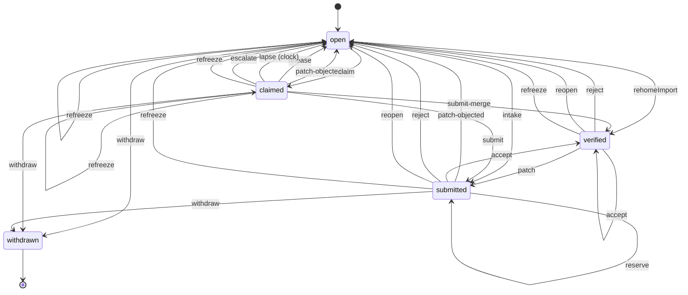

# The item lifecycle

Generated from src/machine.js by `pullboard lifecycle`. Do not edit it by hand: change the declaration, then run `node bin/update-docs.js` to refresh all generated documents.

An item starts open. Its final states, withdrawn, cannot be left. Every move into a guarded state passes the same guards, whatever command gets there. The board file refuses any move not declared here.

## Frozen check policy

The coordinator may set `check.install` and `check.timeout` in committed `pullboard.json`; the defaults are no install and `5m`. Accept runs the configured install and the frozen item check in a private clone under one timeout; a configured `landing.timeout` replaces `check.timeout` as that budget, so a long check reports its real result (#1760). It reuses the verifier’s npm cache if present. Installs that download conflict with P2 (offline); configure an offline install or cache the packages.

Private commands drain output through pipes, keeping a bounded 8 MiB capture of its beginning and end. Failed or unverified checks stream the full log through secret scanning into an owner-readable artifact; lines over 64 KiB of UTF-8 are replaced with a safe-scan marker. Output beyond the cap does not fail a successful command; dependency files and build artifacts have no capture limit. A timeout kills the command's process group. An unverified check names how to restore and retry; a failing one names rejection or builder rework.

## States

| State | Means | Fields it needs |
| --- | --- | --- |
| open | waiting for a builder; claimable once what it waits on is verified | none |
| claimed | an agent holds it under a lease, its criterion frozen | item_owner, item_lease_until, item_frozen_digest |
| submitted | a native build gated green, or an intaken outside commit awaiting sandbox verification, at a pinned commit | item_built_by, item_commit, item_frozen_digest |
| verified | another agent accepted it at the submitted commit, its canonically recorded trunk-only merge, or the item carries an attributed source-board acceptance | item_verified_by, item_commit |
| withdrawn (final) | nobody should build it; the reason stays on it | item_withdrawn_reason |

## Moves

Each move checks its guards in this order and refuses with the first that fails; result-path refusals are listed separately.

| Move | From | To | Who | Guards, in order; result refusals |
| --- | --- | --- | --- | --- |
| patch-objected | claimed, submitted | open | agent | joined (NOT_JOINED or POLICY_SNAPSHOT_STALE or AGENT_REPLACED or SESSION_LEDGER), itemExists (NO_ITEM or ITEM_MOVED), inState (ITEM_PATCH_WINDOW), patchObjection (ITEM_PATCH_WINDOW) |
| patch-claimed | claimed | claimed | coordinator | joined (NOT_JOINED or POLICY_SNAPSHOT_STALE or AGENT_REPLACED or SESSION_LEDGER), itemExists (NO_ITEM or ITEM_MOVED), inState (ITEM_PATCH_STATE), coordinatorOnly (COORDINATOR_ONLY), notMerged (ALREADY_MERGED) |
| patch | submitted, verified | submitted | coordinator | joined (NOT_JOINED or POLICY_SNAPSHOT_STALE or AGENT_REPLACED or SESSION_LEDGER), itemExists (NO_ITEM or ITEM_MOVED), inState (ITEM_PATCH_STATE), coordinatorOnly (COORDINATOR_ONLY), notMerged (ALREADY_MERGED) |
| rehomeImport | open | verified | agent | joined (NOT_JOINED or POLICY_SNAPSHOT_STALE or AGENT_REPLACED or SESSION_LEDGER), itemExists (NO_ITEM or ITEM_MOVED), inState (REHOME_VERDICT), sourceAcceptance (REHOME_VERDICT), atSubmittedCommit (NOT_AT_COMMIT or PIN_TOOLING_CORRUPT or OUTSIDE_LANE or NO_POLICY or BAD_CONFIG or GIT_GRAFTS), notBuilder (SELF_VERIFY or STRICT_REVIEW_TOUCHED or BAD_REVIEW_POLICY or ITEM_PATCH_FORMAT or ITEM_PATCH or VERIFIER_STANDING or SELF_SESSION_VERIFY), criterionUnchanged (CRITERIA_CHANGED or ITEM_PATCH_CHANGED or ITEM_PATCH_SOURCE or ITEM_PATCH or ITEM_PATCH_AUTHOR), proofNoted (PROOF_REQUIRED) |
| intake | open | submitted | agent, coordinator | joined (NOT_JOINED or POLICY_SNAPSHOT_STALE or AGENT_REPLACED or SESSION_LEDGER), itemExists (NO_ITEM or ITEM_MOVED), inState (NOT_CLAIMABLE), outsideSubmission (OUTSIDE_SOURCE) |
| claim | open, claimed | claimed | agent, coordinator | joined (NOT_JOINED or POLICY_SNAPSHOT_STALE or AGENT_REPLACED or SESSION_LEDGER), itemExists (NO_ITEM or ITEM_MOVED), inState (NOT_CLAIMABLE), checkProvesSomething (CRITERION_PROVES_NOTHING), barReady (BAR_NOT_READY or UNDECLARED_BUILDER_FAMILY), itemNotHeld (ITEM_HELD), inLane (WRONG_LANE or OUTSIDE_NATIVE_BUILD), routeAllows (ROUTE or DIAGNOSIS_REQUIRED), buildScopeFits (ITEM_BUILD_BUDGET or BAD_BUILD_BUDGET), dependenciesVerified (BLOCKED), notHeldByAnother (HELD), builderFirstRefusal (REOPEN_HELD_FOR_BUILDER), correctionRefrozen (PENDING_REFREEZE), laneOpen (LANE_HELD), lineCapacity (LINE_WIP_LIMIT or LINE_SETTING_RANGE), oneLiveClaim (ONE_CLAIM), rowsInForce (UNKNOWN_SPEC or A5_GRAMMAR_VERSION or NO_POLICY or BAD_CONFIG or AGENT_APPROVAL_REQUIRED or BAR_NOT_READY), result (SOURCE_ADVANCE_STATE), result (ITEM_PATCH_FORMAT), result (RELAY_MOVE), result (EXIT_CONTINUATION), result (EXIT_USAGE), result (BAD_DEPENDENCIES), result (ITEM_LEASE_LOST), result (ENGINE_VERSION) |
| release | open, claimed | open | agent, coordinator | joined (NOT_JOINED or POLICY_SNAPSHOT_STALE or AGENT_REPLACED or SESSION_LEDGER), itemExists (NO_ITEM or ITEM_MOVED), inState (NOT_YOURS), releaseOwnsWork (NOT_YOURS or RELEASE_REASON or BAD_CONFIG or ENGINE_VERSION), reviewReleaseExplained (NOTE_REQUIRED), result (S10), result (DIAGNOSIS_WRONG), result (BAD_DEPENDENCIES), result (EXIT_CONTINUATION), result (EXIT_SUMMARY), result (EMPTY_FACT), result (FACT_JUDGEMENT), result (BAD_FACT_ID), result (NO_FACT), result (FACT_INDEX_NOT_READY), result (BAD_FACT_KIND), result (BAR_PARENT_UNKNOWN), result (BAR_SELF_SIGN), result (BAD_FACT_REF), result (RIGOR_PERSON_ONLY), result (B26_PERSON_CHANNEL), result (BAD_CAUSE), result (NO_POLICY), result (A5_GRAMMAR_VERSION) |
| lapse | claimed | open | clock, when its lease runs out | none |
| submit | claimed | submitted | agent, coordinator | joined (NOT_JOINED or POLICY_SNAPSHOT_STALE or AGENT_REPLACED or SESSION_LEDGER), itemExists (NO_ITEM or ITEM_MOVED), inState (NOT_YOURS), isHolder (NOT_YOURS or OUTSIDE_NATIVE_BUILD), correctionRefrozen (PENDING_REFREEZE), checkProvesSomething (CRITERION_PROVES_NOTHING), barReady (BAR_NOT_READY or UNDECLARED_BUILDER_FAMILY), clausesInspected (CLAUSE_UNTICKED), criterionUnchanged (CRITERIA_CHANGED or ITEM_PATCH_CHANGED or ITEM_PATCH_SOURCE or ITEM_PATCH or ITEM_PATCH_AUTHOR), treeClean (DIRTY), nothingUntracked (UNTRACKED), hasCommit (NO_COMMIT or HOST_NAME), withinLane (OUTSIDE_LANE or NO_POLICY or BAD_CONFIG or GIT_GRAFTS or LANE_CHECK_FOREIGN), trunkMergeClean (MERGE_CONFLICT or MERGE_CHECK_FAILED or NO_POLICY or NO_TRUNK), sourcePlaced (CELLS_PLAN_UNPLACED), trunkInCandidate (MAIN_NOT_COMPOSED or SUBMIT_PIN_NOT_MAIN), noUnverifiedStack (STACKED_ON_UNVERIFIED or WRONG_BRANCH), doctrineHolds (RATCHET_ROSE or RATCHET_UNCOUNTED), gateConfigured (NO_GATE), queuedItemLease (ITEM_LEASE_LOST or A5_GRAMMAR_VERSION or NOT_A_REPO or NO_CONFIG), gateGreen (GATE_RED or LAND_RUNNER or LAND_RUNNER_FAULT or PIN_TOOLING_CORRUPT or RUNNER_UNAVAILABLE or RUNNER_JOB_LOST or RUNNER_TOOLING_FILES or RUNNER_RESULT_INVALID or RUNNER_RESULT_SIGNATURE or RUNNER_RESULT_SOURCE or RUNNER_WORK_SPEC or RUNNER_LIFECYCLE_PROVIDER or RUNNER_WAIT_DEADLINE or RUNNER_INFRA_RETRY_EXHAUSTED or RUNNER_GUI_SESSION_REQUIRED or LAND_TIMEOUT_CUSTODY or LAND_GATE_OUTPUT or SLOT_DB_LOCKED or TIMING_SLOT_REQUIRED or RUNNER_BROWSER_SLOT_REQUIRED or PIPEFAIL_UNAVAILABLE), proofRecorded (PROOF_RUN_UNAVAILABLE or PROOF_RUN_UNBOUND or PROOF_RUN_ACTOR or PROOF_RUN_STALE or PROOF_RUN_CHANGED), treeStillDuringGate (MOVED_DURING_GATE), submissionProofValid (SUBMISSION_PROOF or NO_TITLE or PARENT_LANE or PARENT_CLOSED or COORDINATOR_CHECK or BAD_CHECK or BAD_REVIEW_FAMILY or REFERENCE_IS_BOARD or B26_PERSON_CHANNEL or REFERENCE_AUTHOR or BRIEF_TOO_LONG or NO_BRIEF or CHECK_MASKS_EXIT or WITHDRAWN or DEPENDENCY_CYCLE or BAD_CHECK_BASELINE or BAR_PARENT_UNKNOWN), childrenDone (CHILDREN_OPEN), headIsNew (HEAD_NOT_NEW), result (AUTH_REQUIRED), result (BAD_BOARD), result (BAD_CAUSE), result (BAD_COMPUTER_NAME), result (BAD_FACT_ID), result (BAD_FACT_KIND), result (BAD_FACT_REF), result (BAD_SINCE), result (BAD_VERDICT_REVIEW), result (BAR_SELF_SIGN), result (BOARD_REFERENCE), result (DEVICE_CRYPTO), result (DEVICE_ENDPOINT), result (DEVICE_FORMAT), result (DEVICE_KEY), result (DEVICE_NOT_ENROLLED), result (DEVICE_REVOKED), result (DEVICE_WRAP_BINDING), result (DEVICE_WRAP_KEY), result (DRIVE_OWNER), result (EMPTY_FACT), result (FACT_INDEX_NOT_READY), result (FACT_JUDGEMENT), result (FLAKE_DIAGNOSE_KEY), result (FLAKE_RATCHET), result (GATE_RUN_EVIDENCE), result (IMPORT_FORMAT), result (IMPORT_NOT_EMPTY), result (IMPORT_SCHEMA), result (IMPORT_VERSION), result (ITEM_HELD), result (ITEM_SIZE_PLAN), result (JOB_FIELDS), result (JOB_LEASED), result (JOB_MISSING), result (JOB_OWNER), result (JOB_STEP_NAME), result (LAND_ADOPT), result (LAND_BATCH), result (LAND_CANDIDATE), result (LAND_CLI_SMOKE), result (LAND_COMPANION_MISSING), result (LAND_COMPANION_SOURCE), result (LAND_COMPOSE), result (LAND_DIAGNOSTIC), result (LAND_DIRTY), result (LAND_EVIDENCE), result (LAND_FLAKE), result (LAND_GATE_TIMEOUT), result (LAND_GIT), result (LAND_HEADER), result (LAND_HOST_NOT_JOINED), result (LAND_INTERACTION), result (LAND_ITEM_MOVED), result (LAND_LEASE_CORRUPT), result (LAND_LEASE_LOST), result (LAND_MAIN_COMPARISON), result (LAND_MERGE), result (LAND_MODULE_PARSE), result (LAND_MODULE_RESOLUTION), result (LAND_MODULE_SOURCE), result (LAND_MOVED), result (LAND_OWNER), result (LAND_PARALLEL_NESTED_GATE), result (LAND_PROVE), result (LAND_PUSH), result (LAND_RECEIPT_REQUIRED), result (LAND_RECEIPT_UNBOUND), result (LAND_REMOTE_MOVED), result (LAND_REPO), result (LAND_SOURCE_CHANGED), result (LAND_STALLED), result (LAND_STATIC_RED), result (LAND_STEP_HANDLER), result (LAND_TEST_DEFECT), result (LAND_TRUNK), result (LAND_TRUNK_MOVED), result (LAND_WAIVER), result (LAND_WORKER), result (LAND_WORKTREE), result (MACHINE_CLAUSE_RED), result (MACHINE_PROOF), result (MAIN_RED_KEY), result (MAIN_RED_REDS), result (NO_FACT), result (OAUTH_CANCELLED), result (OUTSIDE_OWNER_APPROVAL), result (PERSON_ENROLL_AUTH), result (PERSON_ENROLL_EXPIRED), result (PERSON_ENROLL_REVOKED), result (PHONE_APPROVAL_CONTEXT), result (PRIVATE_BOARD_IDENTITY), result (PRIVATE_BOARD_NOT_FOUND), result (PUBLISH_RED), result (RECEIPT_KEY), result (RELAY_ACTOR), result (RELAY_API_VERSION), result (RELAY_BASELINE_EXISTS), result (RELAY_BUSY), result (RELAY_CONFIRMATION_PENDING), result (RELAY_CURSOR), result (RELAY_DIVERGED), result (RELAY_HEALTH), result (RELAY_KEYCHAIN), result (RELAY_KEY_FILE_ENV_MISMATCH), result (RELAY_KEY_MISSING), result (RELAY_KEY_STORAGE), result (RELAY_LINKED), result (RELAY_LOCAL_CHANGED), result (RELAY_MACHINE_STORAGE), result (RELAY_MOVE), result (RELAY_ORDER), result (RELAY_ORIGIN), result (RELAY_PAGE_CACHE), result (RELAY_PRESENTATION_PENDING), result (RELAY_PRESENTATION_PORTS), result (RELAY_RECOVERY_PENDING), result (RELAY_REPLAY_REQUIRED), result (RELAY_RESPONSE), result (RELAY_SNAPSHOT), result (RELAY_SNAPSHOT_BUSY), result (RELAY_STORAGE), result (RELAY_TIMEOUT), result (RELAY_UNAVAILABLE), result (RELAY_URL), result (RELAY_VERSION), result (RIGOR_PERSON_ONLY), result (S10), result (SEAL_AUTH_FAILED), result (SEAL_BINDING), result (SEAL_CRYPTO), result (SEAL_FORMAT), result (SEAL_KEY), result (SEAL_VERSION), result (SNAPSHOT_FORMAT), result (SNAPSHOT_PAGE_FORMAT), result (SPEC_ANSWER), result (SPEC_ANSWER_CHOICES), result (STALE_VERDICT), result (TIMING_RUNNER_RESTRICTION), result (AGENT_APPROVAL_REQUIRED), result (CLAUSE_EVIDENCE_KIND), result (CLAUSE_EVIDENCE_REQUIRED), result (CLAUSE_REASONING_ONLY), result (SUBMIT_RED_LOOP), result (EMPTY_SUBMIT), result (KERNEL_EXPORT_APPROVAL), result (KERNEL_EXPORT_SOURCE), result (SEAL_REVISION), result (SEAL_STALE), result (SEAL_STORE), result (LANE_CHECK_FOREIGN), result (WRONG_BRANCH), result (UNKNOWN_SPEC), result (TEST_SELECTION_SOURCE), result (TEST_TIER_MANIFEST), result (TEST_SELECTION_INCOMPLETE), result (TEST_SELECTION_UNVERIFIED), result (SUBMIT_HANDOFF_CHANGED), result (SUBMIT_HANDOFF_AUTHORITY), result (SUBMIT_HANDOFF_PENDING), result (ENGINE_VERSION), result (ITEM_PATCH_FORMAT), result (SOURCE_ADVANCE_STATE), result (SCHEMA_DRIFT), result (BAD_DEPENDENCIES), result (AGENT_GRANT_EXPIRED), result (AGENT_GRANT_ITEM), result (AGENT_GRANT_LANE), result (LINE_SETTING_RANGE), result (CELLS_PLAN_SHARD), result (CELLS_UNPLACED), result (CELLS_PLAN_COUNTS), result (CELLS_PLAN_RETIRED), result (CELLS_PLAN_GIT), result (CELL_BASELINE), result (CELLS_PLAN_CELL), result (CELLS_ENTRY), result (CELLS_SUBMIT), result (UNDECLARED_BUILDER_FAMILY), result (BAD_REVIEW_POLICY), result (MERGE_ONLY_PROOF), result (SELF_VERIFY), result (SELF_SESSION_VERIFY), result (PROOF_REQUIRED) |
| submit-merge | claimed | verified | agent, coordinator, when only an unchanged accepted bar and a proved trunk-only merge; no new reviewer verdict is created | joined (NOT_JOINED or POLICY_SNAPSHOT_STALE or AGENT_REPLACED or SESSION_LEDGER), itemExists (NO_ITEM or ITEM_MOVED), inState (NOT_YOURS), isHolder (NOT_YOURS or OUTSIDE_NATIVE_BUILD), correctionRefrozen (PENDING_REFREEZE), checkProvesSomething (CRITERION_PROVES_NOTHING), barReady (BAR_NOT_READY or UNDECLARED_BUILDER_FAMILY), clausesInspected (CLAUSE_UNTICKED), criterionUnchanged (CRITERIA_CHANGED or ITEM_PATCH_CHANGED or ITEM_PATCH_SOURCE or ITEM_PATCH or ITEM_PATCH_AUTHOR), treeClean (DIRTY), nothingUntracked (UNTRACKED), hasCommit (NO_COMMIT or HOST_NAME), withinLane (OUTSIDE_LANE or NO_POLICY or BAD_CONFIG or GIT_GRAFTS or LANE_CHECK_FOREIGN), trunkMergeClean (MERGE_CONFLICT or MERGE_CHECK_FAILED or NO_POLICY or NO_TRUNK), sourcePlaced (CELLS_PLAN_UNPLACED), trunkInCandidate (MAIN_NOT_COMPOSED or SUBMIT_PIN_NOT_MAIN), noUnverifiedStack (STACKED_ON_UNVERIFIED or WRONG_BRANCH), doctrineHolds (RATCHET_ROSE or RATCHET_UNCOUNTED), gateConfigured (NO_GATE), queuedItemLease (ITEM_LEASE_LOST or A5_GRAMMAR_VERSION or NOT_A_REPO or NO_CONFIG), gateGreen (GATE_RED or LAND_RUNNER or LAND_RUNNER_FAULT or PIN_TOOLING_CORRUPT or RUNNER_UNAVAILABLE or RUNNER_JOB_LOST or RUNNER_TOOLING_FILES or RUNNER_RESULT_INVALID or RUNNER_RESULT_SIGNATURE or RUNNER_RESULT_SOURCE or RUNNER_WORK_SPEC or RUNNER_LIFECYCLE_PROVIDER or RUNNER_WAIT_DEADLINE or RUNNER_INFRA_RETRY_EXHAUSTED or RUNNER_GUI_SESSION_REQUIRED or LAND_TIMEOUT_CUSTODY or LAND_GATE_OUTPUT or SLOT_DB_LOCKED or TIMING_SLOT_REQUIRED or RUNNER_BROWSER_SLOT_REQUIRED or PIPEFAIL_UNAVAILABLE), proofRecorded (PROOF_RUN_UNAVAILABLE or PROOF_RUN_UNBOUND or PROOF_RUN_ACTOR or PROOF_RUN_STALE or PROOF_RUN_CHANGED), treeStillDuringGate (MOVED_DURING_GATE), submissionProofValid (SUBMISSION_PROOF or NO_TITLE or PARENT_LANE or PARENT_CLOSED or COORDINATOR_CHECK or BAD_CHECK or BAD_REVIEW_FAMILY or REFERENCE_IS_BOARD or B26_PERSON_CHANNEL or REFERENCE_AUTHOR or BRIEF_TOO_LONG or NO_BRIEF or CHECK_MASKS_EXIT or WITHDRAWN or DEPENDENCY_CYCLE or BAD_CHECK_BASELINE or BAR_PARENT_UNKNOWN), childrenDone (CHILDREN_OPEN), headIsNew (HEAD_NOT_NEW), mergeOnlyRecorded (MERGE_ONLY_PROOF), atSubmittedCommit (NOT_AT_COMMIT or PIN_TOOLING_CORRUPT or OUTSIDE_LANE or NO_POLICY or BAD_CONFIG or GIT_GRAFTS), notBuilder (SELF_VERIFY or STRICT_REVIEW_TOUCHED or BAD_REVIEW_POLICY or ITEM_PATCH_FORMAT or ITEM_PATCH or VERIFIER_STANDING or SELF_SESSION_VERIFY), proofNoted (PROOF_REQUIRED), result (ITEM_PATCH_FORMAT), result (SOURCE_ADVANCE_STATE), result (SCHEMA_DRIFT), result (BAD_DEPENDENCIES), result (AGENT_GRANT_EXPIRED), result (AGENT_GRANT_ITEM), result (AGENT_GRANT_LANE) |
| reserve | submitted | submitted | agent, coordinator | coordinatorSaysAs (MAIN_IS_COORDINATOR), joined (NOT_JOINED or POLICY_SNAPSHOT_STALE or AGENT_REPLACED or SESSION_LEDGER), roadmapReadable (MILESTONES_CORRUPT or LINE_SETTING_RANGE), itemExists (NO_ITEM or ITEM_MOVED), inState (NOT_SUBMITTED), gateReceipt (GATE_PENDING), reviewCooldownElapsed (REVIEW_COOLDOWN), companionWindow (COMPANION_WINDOW), notBuilder (SELF_VERIFY or STRICT_REVIEW_TOUCHED or BAD_REVIEW_POLICY or ITEM_PATCH_FORMAT or ITEM_PATCH or VERIFIER_STANDING or SELF_SESSION_VERIFY), routeAllows (ROUTE or DIAGNOSIS_REQUIRED), policyAllows (COORDINATOR_VERIFIES), requiredReviewFamily (REQUIRED_REVIEW_FAMILY), familyAllows (SAME_FAMILY or LINE_SETTING_RANGE or O2_FAMILY_MATCH), reviewFree (REVIEW_HELD), result (SOURCE_ADVANCE_STATE), result (BAD_DEPENDENCIES) |
| accept | submitted, verified | verified | agent, coordinator | coordinatorSaysAs (MAIN_IS_COORDINATOR), joined (NOT_JOINED or POLICY_SNAPSHOT_STALE or AGENT_REPLACED or SESSION_LEDGER), itemExists (NO_ITEM or ITEM_MOVED), inState (NOT_SUBMITTED), gateReceipt (GATE_PENDING), atSubmittedCommit (NOT_AT_COMMIT or PIN_TOOLING_CORRUPT or OUTSIDE_LANE or NO_POLICY or BAD_CONFIG or GIT_GRAFTS), notMerged (ALREADY_MERGED), verdictReviewRecorded (BAD_VERDICT_REVIEW), reviewTreeCurrent (STALE_VERDICT or DIRTY or UNTRACKED or VERDICT_TRUNK_MOVED), companionWindow (COMPANION_WINDOW), notBuilder (SELF_VERIFY or STRICT_REVIEW_TOUCHED or BAD_REVIEW_POLICY or ITEM_PATCH_FORMAT or ITEM_PATCH or VERIFIER_STANDING or SELF_SESSION_VERIFY), routeAllows (ROUTE or DIAGNOSIS_REQUIRED), policyAllows (COORDINATOR_VERIFIES), requiredReviewFamily (REQUIRED_REVIEW_FAMILY), familyAllows (SAME_FAMILY or LINE_SETTING_RANGE or O2_FAMILY_MATCH), reviewFree (REVIEW_HELD), criterionUnchanged (CRITERIA_CHANGED or ITEM_PATCH_CHANGED or ITEM_PATCH_SOURCE or ITEM_PATCH or ITEM_PATCH_AUTHOR), reasonIsMet (BAD_REASON), trunkMergeClean (MERGE_CONFLICT or MERGE_CHECK_FAILED or NO_POLICY or NO_TRUNK), noUnverifiedStack (STACKED_ON_UNVERIFIED or WRONG_BRANCH), queuedItemLease (ITEM_LEASE_LOST or A5_GRAMMAR_VERSION or NOT_A_REPO or NO_CONFIG), itemCheckGreen (CHECK_RED or RUNNER_UNAVAILABLE or RUNNER_JOB_LOST or RUNNER_TOOLING_FILES or RUNNER_RESULT_INVALID or RUNNER_RESULT_SIGNATURE or RUNNER_RESULT_SOURCE or RUNNER_WORK_SPEC or RUNNER_LIFECYCLE_PROVIDER or RUNNER_WAIT_DEADLINE or RUNNER_INFRA_RETRY_EXHAUSTED or RUNNER_BROWSER_SLOT_REQUIRED or RUNNER_GUI_SESSION_REQUIRED or SANDBOX_PROVIDER_REQUIRED or SANDBOX_IMAGE_REQUIRED or SANDBOX_RUNTIME or SANDBOX_EXPORT or SANDBOX_EXECUTION or SANDBOX_CLEANUP_REQUIRED or SANDBOX_CHECK_REQUIRED or CHECK_NO_PROOF or OUTSIDE_SANDBOX_REQUIRED or SLOT_DB_LOCKED or TIMING_SLOT_REQUIRED or CHECK_UNVERIFIED or GUARD_CANNOT_FAIL or GUARD_NOT_FOUND), proofRecorded (PROOF_RUN_UNAVAILABLE or PROOF_RUN_UNBOUND or PROOF_RUN_ACTOR or PROOF_RUN_STALE or PROOF_RUN_CHANGED), proofNoted (PROOF_REQUIRED), result (MAIN_RED_REDS), result (TIMING_RUNNER_RESTRICTION), result (AGENT_APPROVAL_REQUIRED), result (UNKNOWN_SPEC), result (SUBMISSION_PROOF), result (SEAL_REVISION), result (SEAL_STALE), result (TEST_SELECTION_SOURCE), result (TEST_TIER_MANIFEST), result (TEST_SELECTION_INCOMPLETE), result (TEST_SELECTION_UNVERIFIED), result (SUBMIT_HANDOFF_CHANGED), result (SUBMIT_HANDOFF_AUTHORITY), result (SOURCE_ADVANCE_STALE), result (ITEM_PATCH_FORMAT), result (SOURCE_ADVANCE_STATE), result (SCHEMA_DRIFT), result (BAD_DEPENDENCIES), result (AGENT_GRANT_EXPIRED), result (AGENT_GRANT_ITEM), result (AGENT_GRANT_LANE), result (ITEM_PATCH), result (ITEM_PATCH_AUTHOR), result (VERDICT_ENVIRONMENT), result (LAND_HEADER), result (ENGINE_VERSION) |
| reject | submitted, verified | open | agent, coordinator | coordinatorSaysAs (MAIN_IS_COORDINATOR), joined (NOT_JOINED or POLICY_SNAPSHOT_STALE or AGENT_REPLACED or SESSION_LEDGER), itemExists (NO_ITEM or ITEM_MOVED), inState (NOT_SUBMITTED), gateReceipt (GATE_PENDING), atSubmittedCommit (NOT_AT_COMMIT or PIN_TOOLING_CORRUPT or OUTSIDE_LANE or NO_POLICY or BAD_CONFIG or GIT_GRAFTS), notMerged (ALREADY_MERGED), verdictReviewRecorded (BAD_VERDICT_REVIEW), reviewTreeCurrent (STALE_VERDICT or DIRTY or UNTRACKED or VERDICT_TRUNK_MOVED), companionWindow (COMPANION_WINDOW), notBuilder (SELF_VERIFY or STRICT_REVIEW_TOUCHED or BAD_REVIEW_POLICY or ITEM_PATCH_FORMAT or ITEM_PATCH or VERIFIER_STANDING or SELF_SESSION_VERIFY), routeAllows (ROUTE or DIAGNOSIS_REQUIRED), policyAllows (COORDINATOR_VERIFIES), requiredReviewFamily (REQUIRED_REVIEW_FAMILY), familyAllows (SAME_FAMILY or LINE_SETTING_RANGE or O2_FAMILY_MATCH), reviewFree (REVIEW_HELD), criterionUnchanged (CRITERIA_CHANGED or ITEM_PATCH_CHANGED or ITEM_PATCH_SOURCE or ITEM_PATCH or ITEM_PATCH_AUTHOR), reasonCoded (BAD_REASON), noteGiven (NOTE_REQUIRED), causeWellFormed (BAD_CAUSE), clauseWellFormed (BAR_CLAUSE_REQUIRED or BAR_CLAUSE_UNKNOWN or LINE_SETTING_RANGE), result (MAIN_RED_REDS), result (TIMING_RUNNER_RESTRICTION), result (AGENT_APPROVAL_REQUIRED), result (UNKNOWN_SPEC), result (SUBMISSION_PROOF), result (SEAL_REVISION), result (SEAL_STALE), result (TEST_SELECTION_SOURCE), result (TEST_TIER_MANIFEST), result (TEST_SELECTION_INCOMPLETE), result (TEST_SELECTION_UNVERIFIED), result (SUBMIT_HANDOFF_CHANGED), result (SUBMIT_HANDOFF_AUTHORITY), result (SOURCE_ADVANCE_STALE), result (ITEM_PATCH_FORMAT), result (SOURCE_ADVANCE_STATE), result (SCHEMA_DRIFT), result (BAD_DEPENDENCIES), result (AGENT_GRANT_EXPIRED), result (AGENT_GRANT_ITEM), result (AGENT_GRANT_LANE), result (ITEM_PATCH), result (ITEM_PATCH_AUTHOR), result (VERDICT_ENVIRONMENT), result (LAND_HEADER), result (ENGINE_VERSION), result (NOT_YOURS), result (CLOSED) |
| reopen | submitted, verified | open | agent, coordinator | joined (NOT_JOINED or POLICY_SNAPSHOT_STALE or AGENT_REPLACED or SESSION_LEDGER), itemExists (NO_ITEM or ITEM_MOVED), inState (NOT_SUBMITTED), reopenAuthority (COORDINATOR_ONLY or NO_POLICY or GIT_GRAFTS or GIT_REPLACE_REFS or VERDICT_WITHDRAW_FORBIDDEN or VERDICT_WITHDRAW_STATE or REVIEW_HELD), noteGiven (NOTE_REQUIRED), causeWellFormed (BAD_CAUSE), notMerged (ALREADY_MERGED), landingFailureRecorded (LANDING_FAILURE_REQUIRED), trunkConflicts (NOT_CONFLICTING or CONFLICT_FILES or NO_TRUNK or MERGE_CHECK_FAILED), conflictAccepted (NOT_ACCEPTED or BAD_CONFLICT or ENGINE_VERSION), result (LINE_SETTING_RANGE), result (BOARD_RETURNS_REJECTED), result (PROOF_RUN_UNBOUND), result (SOURCE_ADVANCE_STALE), result (SOURCE_ADVANCE_PROOF), result (SOURCE_ADVANCE_STATE), result (ITEM_PATCH_FORMAT), result (BAD_VERDICT_WITHDRAW), result (ENGINE_VERSION), result (BAD_CONFIG) |
| escalate | open, claimed | open | agent, coordinator | joined (NOT_JOINED or POLICY_SNAPSHOT_STALE or AGENT_REPLACED or SESSION_LEDGER), noteGiven (NOTE_REQUIRED), itemExists (NO_ITEM or ITEM_MOVED), holderOrCoordinator (NOT_YOURS), inState (CLOSED) |
| refreeze | open, claimed, submitted, verified | open | coordinator, when there is no live claim awaiting a coordinator correction | joined (NOT_JOINED or POLICY_SNAPSHOT_STALE or AGENT_REPLACED or SESSION_LEDGER), coordinatorOnly (COORDINATOR_ONLY), itemExists (NO_ITEM or ITEM_MOVED), inState (CLOSED), specRefreezeAllowed (CLOSED), barReady (BAR_NOT_READY or UNDECLARED_BUILDER_FAMILY), rowsInForce (UNKNOWN_SPEC or A5_GRAMMAR_VERSION or NO_POLICY or BAD_CONFIG or AGENT_APPROVAL_REQUIRED or BAR_NOT_READY) |
| refreeze | claimed | claimed | agent, coordinator, when a live claim has a pending coordinator correction or a validated cited-spec correction | joined (NOT_JOINED or POLICY_SNAPSHOT_STALE or AGENT_REPLACED or SESSION_LEDGER), itemExists (NO_ITEM or ITEM_MOVED), holderOrCoordinator (NOT_YOURS), inState (CLOSED), specRefreezeAllowed (CLOSED), barReady (BAR_NOT_READY or UNDECLARED_BUILDER_FAMILY), rowsInForce (UNKNOWN_SPEC or A5_GRAMMAR_VERSION or NO_POLICY or BAD_CONFIG or AGENT_APPROVAL_REQUIRED or BAR_NOT_READY) |
| withdraw | open, claimed, submitted | withdrawn | coordinator | joined (NOT_JOINED or POLICY_SNAPSHOT_STALE or AGENT_REPLACED or SESSION_LEDGER), coordinatorOnly (COORDINATOR_ONLY), noteGiven (NOTE_REQUIRED), itemExists (NO_ITEM or ITEM_MOVED), mainRedUnchanged (STALE_MAIN_RED or NO_POLICY), inState (CLOSED) |

## Required transition guards

| State entered | Every move into it passes |
| --- | --- |
| verified | atSubmittedCommit, notBuilder, criterionUnchanged, proofNoted |
| withdrawn | coordinatorOnly, noteGiven |

## Refusals

| Code | Raised when this does not hold | Next step |
| --- | --- | --- |
| ITEM_PATCH_WINDOW | patch-objected: the item is in claimed, submitted | pullboard show <id> |
| ITEM_PATCH_STATE | patch-claimed: the item is in claimed | pullboard show <id> |
| ITEM_PATCH_STATE | patch: the item is in submitted, verified | pullboard show <id> |
| REHOME_VERDICT | rehomeImport: the item is in open | pullboard show <id> |
| NOT_CLAIMABLE | intake: the item is in open | pullboard show <id> |
| NOT_CLAIMABLE | claim: the item is in open, claimed | pullboard show <id> |
| NOT_YOURS | release: the item is in open, claimed | pullboard show <id> |
| NOT_YOURS | submit: the item is in claimed | pullboard show <id> |
| NOT_YOURS | submit-merge: the item is in claimed | pullboard show <id> |
| NOT_SUBMITTED | reserve: the item is in submitted | pullboard show <id> |
| NOT_SUBMITTED | accept: the item is in submitted, verified | pullboard show <id> |
| NOT_SUBMITTED | reject: the item is in submitted, verified | pullboard show <id> |
| NOT_SUBMITTED | reopen: the item is in submitted, verified | pullboard show <id> |
| CLOSED | escalate: the item is in open, claimed | pullboard show <id> |
| CLOSED | refreeze: the item is in open, claimed, submitted, verified | pullboard show <id> |
| CLOSED | refreeze: the item is in claimed | pullboard show <id> |
| CLOSED | withdraw: the item is in open, claimed, submitted | pullboard show <id> |
| CLAUSE_UNTICKED | an explicitly inspected submit carries matching holder evidence for each declared criterion clause | tick each named clause with its declared evidence kind, then submit again |
| REHOME_VERDICT | the authenticated destination mover attests to an exact source board ACCEPT reference keyed by the ordered source MOVEID and result digest | preserve the imported source acceptance attribution, frozen digest, commit and verifier reference |
| MERGE_ONLY_PROOF | the sealed submit records the origin’s Git-derived carry, unchanged bar and original verifier; landing re-proves its heads, trees and resolution hash before merging | submit normally for outside review if the origin cannot prove the merge |
| CLOSED | an unmerged acceptance is refrozen only within a validated cited-spec correction | apply the person-approved cited spec correction, or reopen through the normal review workflow |
| OUTSIDE_SOURCE | an outside author and exact fetched commit/tree are recorded with a trusted frozen criterion, without pretending a native builder gated it | fetch and intake the exact GitHub pull request again |
| NOT_JOINED | the caller is the main checkout, or an unreplaced worktree seat that joined a lane; an agent session's claims, submits and verdicts can be checked against its local ledger | pullboard join <lane> --model "<model name>" (see: pullboard lanes) |
| POLICY_SNAPSHOT_STALE | the caller is the main checkout, or an unreplaced worktree seat that joined a lane; an agent session's claims, submits and verdicts can be checked against its local ledger | retry the original command from the top against current accepted main; its stale database transaction was rolled back |
| AGENT_REPLACED | the caller is the main checkout, or an unreplaced worktree seat that joined a lane; an agent session's claims, submits and verdicts can be checked against its local ledger | read the takeover and only shout on its exact hand-off item; continue work from the incoming agent worktree |
| SESSION_LEDGER | the caller is the main checkout, or an unreplaced worktree seat that joined a lane; an agent session's claims, submits and verdicts can be checked against its local ledger | make the agent-session ledger named in the message readable and writable by this user, then run the command again |
| NO_ITEM | the item exists and has not been moved | pullboard list --all |
| ITEM_MOVED | the item exists and has not been moved | use the recorded destination reference shown in the refusal; do not move the old ID again |
| ITEM_PATCH_WINDOW | a registered owner in the companion patch lane objects before the recorded review deadline | read pullboard patch list <id>; only the named lane owner may object during its window |
| GATE_PENDING | the submitted head has a captured gate proof receipt before it is reserved or given a verdict | pullboard next --verify, which offers the item once its gate result and receipt exist |
| COMPANION_WINDOW | the automatic companion objection window has elapsed before review is reserved | wait for the owner objection window to end, or ask the owning lane to object |
| COORDINATOR_ONLY | the coordinator reopens, the native board computes an automatic submitted-head conflict, or the exact accepting reviewer withdraws its verdict; older recorded submitted-conflict moves keep their joined-seat authority | ask the coordinator or the reviewer who recorded the accept |
| NO_POLICY | the coordinator reopens, the native board computes an automatic submitted-head conflict, or the exact accepting reviewer withdraws its verdict; older recorded submitted-conflict moves keep their joined-seat authority | restore the local Git configuration so the current trunk can be read, then compute a fresh automatic return |
| GIT_GRAFTS | the coordinator reopens, the native board computes an automatic submitted-head conflict, or the exact accepting reviewer withdraws its verdict; older recorded submitted-conflict moves keep their joined-seat authority | ask the coordinator to remove the replica graft file, then resume the same move |
| GIT_REPLACE_REFS | the coordinator reopens, the native board computes an automatic submitted-head conflict, or the exact accepting reviewer withdraws its verdict; older recorded submitted-conflict moves keep their joined-seat authority | ask the coordinator to remove the replica replacement refs, then resume the same move |
| VERDICT_WITHDRAW_FORBIDDEN | the coordinator reopens, the native board computes an automatic submitted-head conflict, or the exact accepting reviewer withdraws its verdict; older recorded submitted-conflict moves keep their joined-seat authority | ask the accepting reviewer or coordinator to withdraw the verdict |
| VERDICT_WITHDRAW_STATE | the coordinator reopens, the native board computes an automatic submitted-head conflict, or the exact accepting reviewer withdraws its verdict; older recorded submitted-conflict moves keep their joined-seat authority | refresh the item; only a current acceptance before landing can be withdrawn |
| REVIEW_HELD | the coordinator reopens, the native board computes an automatic submitted-head conflict, or the exact accepting reviewer withdraws its verdict; older recorded submitted-conflict moves keep their joined-seat authority | take another review: pullboard next --verify |
| COORDINATOR_ONLY | the caller is the coordinator | run it from the main checkout |
| MILESTONES_CORRUPT | the recorded queue policy and roadmap are readable when selecting the next review, only next --verify selection; a review reserved by id does not consult the roadmap | restore board metadata from a known-good board export |
| LINE_SETTING_RANGE | the recorded queue policy and roadmap are readable when selecting the next review, only next --verify selection; a review reserved by id does not consult the roadmap | restore the recorded board line setting from its ordered event history, then retry next --verify |
| MAIN_IS_COORDINATOR | in the main checkout, the caller says it is the coordinator | verify from your own worktree; the coordinator adds --as coordinator |
| NOT_YOURS | the caller holds the item, or is the coordinator | shout its holder, or the coordinator |
| NOT_YOURS | the caller holds the claim, yields its own first-refusal window, or is the coordinator recording a complete gone-seat or stale-claim observation | release your own claim or reservation, or ask the current builder |
| RELEASE_REASON | the caller holds the claim, yields its own first-refusal window, or is the coordinator recording a complete gone-seat or stale-claim observation | release with --reason <code> |
| BAD_CONFIG | the caller holds the claim, yields its own first-refusal window, or is the coordinator recording a complete gone-seat or stale-claim observation | fix pullboard.json as the message says, then commit it: git commit -m "chore: fix pullboard config" pullboard.json |
| ENGINE_VERSION | the caller holds the claim, yields its own first-refusal window, or is the coordinator recording a complete gone-seat or stale-claim observation | upgrade Pullboard on every linked device before using automatic or stale claim release |
| NOT_YOURS | the caller holds the claim | pullboard claim <id> |
| OUTSIDE_NATIVE_BUILD | the caller holds the claim | the outside author revises the PR; ask the coordinator to return it, then intake the new exact head |
| WRONG_LANE | the item is in the caller's lane; the main checkout builds coordinator-lane items only | cd <the lane's worktree> && pullboard claim <id> |
| OUTSIDE_NATIVE_BUILD | the item is in the caller's lane; the main checkout builds coordinator-lane items only | the outside author revises the PR; ask the coordinator to return it, then intake the new exact head |
| ROUTE | the caller's route covers the item's: light, then mid, then strong | pullboard next, which offers only items your route covers |
| DIAGNOSIS_REQUIRED | the caller's route covers the item's: light, then mid, then strong | have a mid or strong seat record Files, Change and Test case with pullboard fact <id> diagnosis before a light seat claims it |
| ITEM_BUILD_BUDGET | known expected build minutes fit the captured board budget before a new claim | cut the item into a parent and children whose expected minutes fit the budget; claim a child |
| BAD_BUILD_BUDGET | known expected build minutes fit the captured board budget before a new claim | restore a positive itemBuildBudgetMinutes setting, then retry |
| BLOCKED | every item it waits on is verified | claim another item, or shout the lane it waits on |
| REOPEN_HELD_FOR_BUILDER | a returned item waits for its original builder until its recorded deadline or builder release | wait until the named deadline, or ask its builder to run pullboard release <id> |
| HELD | no other agent holds it under a live lease | pullboard next |
| LANE_HELD | nobody holds its lane, unless the caller is renewing its own live claim | pullboard next --wait 9 (minutes) |
| ITEM_HELD | the coordinator has not put this item on hold, unless the caller is renewing its own live claim | the coordinator lifts it with pullboard hold <id> --off |
| PENDING_REFREEZE | no coordinator correction to a claimed criterion or check is waiting to be frozen | pullboard refreeze <id> |
| LINE_WIP_LIMIT | a new claim stays within recorded WIP per active reviewer, only for new claims while wipPerReviewer is on | review the oldest eligible waiting submission: pullboard next --verify |
| LINE_SETTING_RANGE | a new claim stays within recorded WIP per active reviewer, only for new claims while wipPerReviewer is on | restore the malformed recorded line setting before claiming |
| ONE_CLAIM | the caller holds no other live top-level claim, reworks of its own rejected items aside | submit or release the other item first; child items are free |
| UNKNOWN_SPEC | every row the item cites exists and is in force, only where the criterion freezes: claiming an item with no frozen criterion, and refreeze | fix the spec, or the coordinator withdraws the item |
| A5_GRAMMAR_VERSION | every row the item cites exists and is in force, only where the criterion freezes: claiming an item with no frozen criterion, and refreeze | upgrade Pullboard or use a file written for grammar 1 |
| NO_POLICY | every row the item cites exists and is in force, only where the criterion freezes: claiming an item with no frozen criterion, and refreeze | restore the committed coordinator policy |
| BAD_CONFIG | every row the item cites exists and is in force, only where the criterion freezes: claiming an item with no frozen criterion, and refreeze | repair and commit the coordinator configuration |
| AGENT_APPROVAL_REQUIRED | every row the item cites exists and is in force, only where the criterion freezes: claiming an item with no frozen criterion, and refreeze | ask the coordinator to arrange the person’s confirmation or decline, or change the explicit refuse setting |
| BAR_NOT_READY | every row the item cites exists and is in force, only where the criterion freezes: claiming an item with no frozen criterion, and refreeze | another parent session signs coverage for the current accepted test inventory and runner |
| CRITERIA_CHANGED | the criterion and the rows it cites read as they did at claim | the coordinator runs pullboard refreeze <id> |
| ITEM_PATCH_CHANGED | the criterion and the rows it cites read as they did at claim | compose the current patch set and rerun review |
| ITEM_PATCH_SOURCE | the criterion and the rows it cites read as they did at claim | replace stale patches against the current submitted source |
| ITEM_PATCH | the criterion and the rows it cites read as they did at claim | replace the unsafe or conflicting patch with a source-bound correction |
| ITEM_PATCH_AUTHOR | the criterion and the rows it cites read as they did at claim | restore the native author before reviewing the patch |
| DIRTY | the worktree has no uncommitted changes | commit your changes, then submit |
| CELLS_PLAN_UNPLACED | when accepted main carries the cells plan, every in-scope committed source path has a placement | run node bin/cells-plan.js --place <path> --cell <cell> (or --stay), commit the source and plan, then submit |
| UNTRACKED | the worktree has no untracked files | commit or ignore them, then submit |
| NO_COMMIT | there is a commit to submit, and no commit it adds names this machine | commit your work, then submit |
| HOST_NAME | there is a commit to submit, and no commit it adds names this machine | reword the named commit's message without this machine's name (git rebase -i, then reword), then run pullboard submit <id> again |
| NO_GATE | the repo names a gate command | in the main checkout, run pullboard gate set "<project test command>", then commit pullboard.json |
| OUTSIDE_LANE | the full claimed diff respects committed coordinator ownership | restore foreign paths or shout their owner |
| NO_POLICY | the full claimed diff respects committed coordinator ownership | restore the claim base or ask the coordinator to refreeze |
| BAD_CONFIG | the full claimed diff respects committed coordinator ownership | restore the committed coordinator configuration |
| GIT_GRAFTS | the full claimed diff respects committed coordinator ownership | ask the coordinator to remove the Git graft file before retrying |
| LANE_CHECK_FOREIGN | the full claimed diff respects committed coordinator ownership | shout the owner named in the message to set a check that names that file, or name only your own lane's test files |
| MERGE_CONFLICT | the candidate merges cleanly into the current primary branch without changing an index or worktree | merge the trunk into your branch, resolve conflicts, commit and resubmit |
| MERGE_CHECK_FAILED | the candidate merges cleanly into the current primary branch without changing an index or worktree | use Git 2.38 or newer, restore its objects and retry |
| NO_POLICY | the candidate merges cleanly into the current primary branch without changing an index or worktree | restore the primary repository metadata |
| NO_TRUNK | the candidate merges cleanly into the current primary branch without changing an index or worktree | check out the trunk branch in the main checkout once and run pullboard inbox |
| MAIN_NOT_COMPOSED | the candidate contains the main its submission proof pins; a main that moves during the proof is merged without a rerun only when none of its commits touches a file the item changes, its check runs or its affected tests read, bar ready is enabled for this board | merge main, commit the composition, then submit again |
| SUBMIT_PIN_NOT_MAIN | the candidate contains the main its submission proof pins; a main that moves during the proof is merged without a rerun only when none of its commits touches a file the item changes, its check runs or its affected tests read, bar ready is enabled for this board | run pullboard submit again so it captures the current main |
| STACKED_ON_UNVERIFIED | the candidate range contains no other item's unverified submitted commit | wait for that item to be accepted, or rebuild without its commits |
| WRONG_BRANCH | the candidate range contains no other item's unverified submitted commit | submit the item named in the message from this head, or switch to the branch built for this item |
| RATCHET_ROSE | every touched doctrine check counts (exit 0 or 1), none rises above its committed count and no changed file gains a problem; watch-mode rules only count, only when accepted main has an approved doctrine rule with gate: check | fix the new problems, commit, submit again; only the person's signature raises count: |
| RATCHET_UNCOUNTED | every touched doctrine check counts (exit 0 or 1), none rises above its committed count and no changed file gains a problem; watch-mode rules only count, only when accepted main has an approved doctrine rule with gate: check | fix the check so it exits 0 or 1 within its timeout, then submit again |
| CHECK_RED | the frozen item check passes at the submitted commit, or its clean reviewed composition for a stale acceptance | reject the failing behavior; the builder fixes and resubmits |
| RUNNER_UNAVAILABLE | the frozen item check passes at the submitted commit, or its clean reviewed composition for a stale acceptance | inspect the unavailable runner and its exact cleanup generation; restore it before another attempt |
| RUNNER_JOB_LOST | the frozen item check passes at the submitted commit, or its clean reviewed composition for a stale acceptance | inspect the exact runner and job named in the diagnostic; cleanup remains unknown until the pinned worker proves it, then retry |
| RUNNER_TOOLING_FILES | the frozen item check passes at the submitted commit, or its clean reviewed composition for a stale acceptance | repair package.json files or the named worker import, keeping the runner transfer bound unchanged |
| RUNNER_RESULT_INVALID | the frozen item check passes at the submitted commit, or its clean reviewed composition for a stale acceptance | inspect the retained transport diagnostic and repair the named protocol or capsule failure before retrying |
| RUNNER_RESULT_SIGNATURE | the frozen item check passes at the submitted commit, or its clean reviewed composition for a stale acceptance | re-register the runner with pullboard runner add before accepting another result |
| RUNNER_RESULT_SOURCE | the frozen item check passes at the submitted commit, or its clean reviewed composition for a stale acceptance | discard the mismatched result and rerun the pinned source |
| RUNNER_WORK_SPEC | the frozen item check passes at the submitted commit, or its clean reviewed composition for a stale acceptance | upgrade or repair the controller and runner together, then retry the named invalid work specification |
| RUNNER_LIFECYCLE_PROVIDER | the frozen item check passes at the submitted commit, or its clean reviewed composition for a stale acceptance | restart with the current installed controller so its canonical item lifecycle observer is composed |
| RUNNER_WAIT_DEADLINE | the frozen item check passes at the submitted commit, or its clean reviewed composition for a stale acceptance | check the runners the message names, or restore local gate capacity with pullboard settings, then retry |
| RUNNER_INFRA_RETRY_EXHAUSTED | the frozen item check passes at the submitted commit, or its clean reviewed composition for a stale acceptance | inspect the retained runner diagnostic, restore the named runner, then retry this command |
| RUNNER_BROWSER_SLOT_REQUIRED | the frozen item check passes at the submitted commit, or its clean reviewed composition for a stale acceptance | nothing to do: the run reruns on a local gate slot; if it repeats, set gate.browserByLaunch the same on this machine and that runner |
| RUNNER_GUI_SESSION_REQUIRED | the frozen item check passes at the submitted commit, or its clean reviewed composition for a stale acceptance | nothing to do: the run reruns locally; log in to a GUI session on the runner before sending GUI-marked files there |
| SANDBOX_PROVIDER_REQUIRED | the frozen item check passes at the submitted commit, or its clean reviewed composition for a stale acceptance | configure the committed main Docker provider and pinned minimum/current images |
| SANDBOX_IMAGE_REQUIRED | the frozen item check passes at the submitted commit, or its clean reviewed composition for a stale acceptance | preload the exact pinned official image into the configured daemon |
| SANDBOX_RUNTIME | the frozen item check passes at the submitted commit, or its clean reviewed composition for a stale acceptance | correct the pinned image so its actual Node version matches its role |
| SANDBOX_EXPORT | the frozen item check passes at the submitted commit, or its clean reviewed composition for a stale acceptance | restore access to the exact private Git export and recorded tree |
| SANDBOX_EXECUTION | the frozen item check passes at the submitted commit, or its clean reviewed composition for a stale acceptance | restore the Docker runtime and inspect the owned container before another verification |
| SANDBOX_CLEANUP_REQUIRED | the frozen item check passes at the submitted commit, or its clean reviewed composition for a stale acceptance | remove the exact named owned container after restoring Docker |
| SANDBOX_CHECK_REQUIRED | the frozen item check passes at the submitted commit, or its clean reviewed composition for a stale acceptance | set a trusted full gate and frozen criterion before intake |
| CHECK_NO_PROOF | the frozen item check passes at the submitted commit, or its clean reviewed composition for a stale acceptance | strengthen the criterion so it fails before the outside change |
| OUTSIDE_SANDBOX_REQUIRED | the frozen item check passes at the submitted commit, or its clean reviewed composition for a stale acceptance | verify the outside item with --sandbox using the configured container provider |
| SLOT_DB_LOCKED | the frozen item check passes at the submitted commit, or its clean reviewed composition for a stale acceptance | the run never started, so it is not a red; rerun the same command once the named process releases the slot database |
| TIMING_SLOT_REQUIRED | the frozen item check passes at the submitted commit, or its clean reviewed composition for a stale acceptance | start the timing check outside its inherited ordinary lease and acquire the machine gate with timing true |
| CHECK_UNVERIFIED | the frozen item check passes at the submitted commit, or its clean reviewed composition for a stale acceptance | restore the frozen install or check environment and retry |
| GUARD_CANNOT_FAIL | the frozen item check passes at the submitted commit, or its clean reviewed composition for a stale acceptance | reject: the check stays green with the named guard reverted |
| GUARD_NOT_FOUND | the frozen item check passes at the submitted commit, or its clean reviewed composition for a stale acceptance | the named guard is not in the submitted commit; ask the coordinator to fix it |
| BAR_NOT_READY | an opted-in new bar has a named red baseline, measurement notes, reviewer edges and a revision-bound signature from another parent session, bar ready is on and this bar was frozen or edited after activation | the author completes the brief, then another parent runs pullboard bar sign <id> |
| UNDECLARED_BUILDER_FAMILY | an opted-in new bar has a named red baseline, measurement notes, reviewer edges and a revision-bound signature from another parent session, bar ready is on and this bar was frozen or edited after activation | run pullboard join <lane> --family <vendor> --model "<model name>", then claim again |
| CRITERION_PROVES_NOTHING | the item's check does not already pass on main, or the person accepted that exact check, only when accepted main sets checks.provesNothing to "hold" | set a check that fails before the work, or the person runs pullboard check accept <id> |
| GATE_RED | the item check is green; submission proof is green or every failure matches exact main or a live person waiver | fix what the digest names, commit, submit again |
| LAND_RUNNER | the item check is green; submission proof is green or every failure matches exact main or a live person waiver | run the landing through its in-process batch runner |
| LAND_RUNNER_FAULT | the item check is green; submission proof is green or every failure matches exact main or a live person waiver | the landing retries by itself; wait for the next attempt |
| PIN_TOOLING_CORRUPT | the item check is green; submission proof is green or every failure matches exact main or a live person waiver | delete the unreadable tooling pin file; the next landing rewrites it |
| RUNNER_UNAVAILABLE | the item check is green; submission proof is green or every failure matches exact main or a live person waiver | inspect the unavailable runner and its exact cleanup generation; restore it before another attempt |
| RUNNER_JOB_LOST | the item check is green; submission proof is green or every failure matches exact main or a live person waiver | inspect the exact runner and job named in the diagnostic; cleanup remains unknown until the pinned worker proves it, then retry |
| RUNNER_TOOLING_FILES | the item check is green; submission proof is green or every failure matches exact main or a live person waiver | repair package.json files or the named worker import, keeping the runner transfer bound unchanged |
| RUNNER_RESULT_INVALID | the item check is green; submission proof is green or every failure matches exact main or a live person waiver | inspect the retained transport diagnostic and repair the named protocol or capsule failure before retrying |
| RUNNER_RESULT_SIGNATURE | the item check is green; submission proof is green or every failure matches exact main or a live person waiver | re-register the runner with pullboard runner add before accepting another result |
| RUNNER_RESULT_SOURCE | the item check is green; submission proof is green or every failure matches exact main or a live person waiver | discard the mismatched result and rerun the pinned source |
| RUNNER_WORK_SPEC | the item check is green; submission proof is green or every failure matches exact main or a live person waiver | upgrade or repair the controller and runner together, then retry the named invalid work specification |
| RUNNER_LIFECYCLE_PROVIDER | the item check is green; submission proof is green or every failure matches exact main or a live person waiver | restart with the current installed controller so its canonical item lifecycle observer is composed |
| RUNNER_WAIT_DEADLINE | the item check is green; submission proof is green or every failure matches exact main or a live person waiver | check the runners the message names, or restore local gate capacity with pullboard settings, then retry |
| RUNNER_INFRA_RETRY_EXHAUSTED | the item check is green; submission proof is green or every failure matches exact main or a live person waiver | inspect the retained runner diagnostic, restore the named runner, then retry this command |
| RUNNER_GUI_SESSION_REQUIRED | the item check is green; submission proof is green or every failure matches exact main or a live person waiver | nothing to do: the run reruns locally; log in to a GUI session on the runner before sending GUI-marked files there |
| LAND_TIMEOUT_CUSTODY | the item check is green; submission proof is green or every failure matches exact main or a live person waiver | inspect the saved timed gate cleanup state and stop only its proven owned processes before starting another landing |
| LAND_GATE_OUTPUT | the item check is green; submission proof is green or every failure matches exact main or a live person waiver | inspect the retained timed gate output directory and free disk space, then start another landing |
| SLOT_DB_LOCKED | the item check is green; submission proof is green or every failure matches exact main or a live person waiver | the run never started, so it is not a red; rerun the same command once the named process releases the slot database |
| TIMING_SLOT_REQUIRED | the item check is green; submission proof is green or every failure matches exact main or a live person waiver | start the timing check outside its inherited ordinary lease and acquire the machine gate with timing true |
| RUNNER_BROWSER_SLOT_REQUIRED | the item check is green; submission proof is green or every failure matches exact main or a live person waiver | nothing to do: the run reruns on a local gate slot; if it repeats, set gate.browserByLaunch the same on this machine and that runner |
| PIPEFAIL_UNAVAILABLE | the item check is green; submission proof is green or every failure matches exact main or a live person waiver | rewrite the gate without a pipe |
| ITEM_LEASE_LOST | the caller still owns the same live item claim or review and can renew it against the frozen criterion, while submit or an accept waits for a machine slot, and once immediately before admission | claim or reserve the item again before retrying the command |
| A5_GRAMMAR_VERSION | the caller still owns the same live item claim or review and can renew it against the frozen criterion, while submit or an accept waits for a machine slot, and once immediately before admission | upgrade Pullboard or restore a spec written for grammar 1, then retry |
| NOT_A_REPO | the caller still owns the same live item claim or review and can renew it against the frozen criterion, while submit or an accept waits for a machine slot, and once immediately before admission | restore the worktree Git metadata, then retry the command |
| NO_CONFIG | the caller still owns the same live item claim or review and can renew it against the frozen criterion, while submit or an accept waits for a machine slot, and once immediately before admission | restore pullboard.json in this worktree, then retry the command |
| PROOF_RUN_UNAVAILABLE | every executed proof is recorded from its native gate receipt before the item outcome | restore receipt storage and read pullboard show <id> |
| PROOF_RUN_UNBOUND | every executed proof is recorded from its native gate receipt before the item outcome | restore the native gate receipt; do not supply provenance by hand |
| PROOF_RUN_ACTOR | every executed proof is recorded from its native gate receipt before the item outcome | use the receipt from your own seat |
| PROOF_RUN_STALE | every executed proof is recorded from its native gate receipt before the item outcome | read the changed criterion before running a new proof |
| PROOF_RUN_CHANGED | every executed proof is recorded from its native gate receipt before the item outcome | keep the original receipt and run a new proof |
| MOVED_DURING_GATE | when the gate ends, HEAD and every tracked file are as they were when it started | leave the worktree alone until the gate finishes, then submit again |
| CHILDREN_OPEN | every child item is verified or withdrawn | finish the child items, or the coordinator withdraws them |
| HEAD_NOT_NEW | a verifier has not rejected this commit at this bar; after a no-verdict reopen, the bar was refrozen | commit the rework, or refreeze the bar after a no-verdict reopen before resubmitting the same commit |
| NOT_AT_COMMIT | the caller's checkout contains the submitted commit | git switch --detach <commit> |
| PIN_TOOLING_CORRUPT | the caller's checkout contains the submitted commit | delete the unreadable tooling pin file; the next landing rewrites it |
| OUTSIDE_LANE | the caller's checkout contains the submitted commit | restore foreign paths before accepting |
| NO_POLICY | the caller's checkout contains the submitted commit | restore the frozen policy objects |
| BAD_CONFIG | the caller's checkout contains the submitted commit | repair the committed coordinator configuration |
| GIT_GRAFTS | the caller's checkout contains the submitted commit | ask the coordinator to remove the Git graft file before retrying |
| BAD_VERDICT_REVIEW | a new review binds the submitted commit, its exact checked commit, a valid trunk commit and canonical candidate paths | restore the submitted Git objects and retry the review with current Pullboard |
| STALE_VERDICT | a stale acceptance is re-reviewed at a clean HEAD containing the current trunk, which stays fixed through its check | merge current main into the submitted commit and re-review it |
| DIRTY | a stale acceptance is re-reviewed at a clean HEAD containing the current trunk, which stays fixed through its check | commit the reviewed composition before re-reviewing |
| UNTRACKED | a stale acceptance is re-reviewed at a clean HEAD containing the current trunk, which stays fixed through its check | commit or ignore untracked files before re-reviewing |
| VERDICT_TRUNK_MOVED | a stale acceptance is re-reviewed at a clean HEAD containing the current trunk, which stays fixed through its check | merge the latest main and re-review the clean composition |
| SELF_VERIFY | the decision’s verifier did not build it, and its agent session did not build or submit it under any seat; a carried verdict retains its original native authority while rechecking all author identities; for a fresh review on a linked board, at engine 48 or newer, the caller was enrolled through the relay by a line of creating seats from the coordinator that includes neither the builder nor a machine join | another agent verifies it: pullboard next --verify |
| STRICT_REVIEW_TOUCHED | the decision’s verifier did not build it, and its agent session did not build or submit it under any seat; a carried verdict retains its original native authority while rechecking all author identities; for a fresh review on a linked board, at engine 48 or newer, the caller was enrolled through the relay by a line of creating seats from the coordinator that includes neither the builder nor a machine join | ask a session that has not written to this strict item |
| BAD_REVIEW_POLICY | the decision’s verifier did not build it, and its agent session did not build or submit it under any seat; a carried verdict retains its original native authority while rechecking all author identities; for a fresh review on a linked board, at engine 48 or newer, the caller was enrolled through the relay by a line of creating seats from the coordinator that includes neither the builder nor a machine join | restore the native review policy before reviewing this item |
| ITEM_PATCH_FORMAT | the decision’s verifier did not build it, and its agent session did not build or submit it under any seat; a carried verdict retains its original native authority while rechecking all author identities; for a fresh review on a linked board, at engine 48 or newer, the caller was enrolled through the relay by a line of creating seats from the coordinator that includes neither the builder nor a machine join | restore readable native patch metadata from its ordered history |
| ITEM_PATCH | the decision’s verifier did not build it, and its agent session did not build or submit it under any seat; a carried verdict retains its original native authority while rechecking all author identities; for a fresh review on a linked board, at engine 48 or newer, the caller was enrolled through the relay by a line of creating seats from the coordinator that includes neither the builder nor a machine join | replace the unsafe or conflicting patch with a source-bound correction |
| VERIFIER_STANDING | the decision’s verifier did not build it, and its agent session did not build or submit it under any seat; a carried verdict retains its original native authority while rechecking all author identities; for a fresh review on a linked board, at engine 48 or newer, the caller was enrolled through the relay by a line of creating seats from the coordinator that includes neither the builder nor a machine join | the coordinator makes an independent verifier from the main checkout: pullboard worktree <lane> --model "<model name>" |
| SELF_SESSION_VERIFY | the decision’s verifier did not build it, and its agent session did not build or submit it under any seat; a carried verdict retains its original native authority while rechecking all author identities; for a fresh review on a linked board, at engine 48 or newer, the caller was enrolled through the relay by a line of creating seats from the coordinator that includes neither the builder nor a machine join | ask another agent session to verify it: pullboard next --verify from that session's own worktree |
| COORDINATOR_VERIFIES | the repo's verify policy lets the caller verify this lane's work | the coordinator verifies it |
| REQUIRED_REVIEW_FAMILY | an item required reviewer family matches the declared reviewer family case-insensitively; undeclared is ineligible, the item declares a required reviewer family | ask a reviewer whose declared family matches the item requirement |
| SAME_FAMILY | strict reviews require different declared vendor families; the existing vendor policy and explicit board or item family requirements also apply, when the item is strict, verify.family is require, an item requires a family, or requireReviewFamilies is on for unknown families | ask the coordinator for a verifier from another declared family |
| LINE_SETTING_RANGE | strict reviews require different declared vendor families; the existing vendor policy and explicit board or item family requirements also apply, when the item is strict, verify.family is require, an item requires a family, or requireReviewFamilies is on for unknown families | restore the recorded board line setting to its valid value before reviewing |
| O2_FAMILY_MATCH | strict reviews require different declared vendor families; the existing vendor policy and explicit board or item family requirements also apply, when the item is strict, verify.family is require, an item requires a family, or requireReviewFamilies is on for unknown families | ask the coordinator for a verifier from another declared family |
| REVIEW_HELD | no other agent holds its review under a live lease | pullboard next --verify, which passes over reviews another agent holds |
| BAD_REASON | an accept gives CRITERION_MET as its reason | a failed criterion is a reject: pullboard verify <id> reject --reason CODE --clause "<frozen wording>" |
| PROOF_REQUIRED | an accept notes how it was proved | --note "what you broke or which edge you tried, and what happened" |
| BAD_REASON | a reject names one of the reject reasons | --reason TEST_FAILURE, BEHAVIOR_MISMATCH, INSUFFICIENT_EVIDENCE, STALE_HEAD or OTHER |
| NOTE_REQUIRED | a review release gives a nonempty one-line reason, engine 5 or newer, only when freeing a submitted review reservation | release with --note "why", or --note-file <file> |
| REVIEW_COOLDOWN | the reviewer has not released this submission within the past hour, engine 5 or newer, only for the same reviewer and current submission | let another reviewer take it, or wait an hour or for a new submission |
| NOTE_REQUIRED | the move carries a note: what failed, what was tried, or why | --note "..." or --note-file <file> |
| STALE_MAIN_RED | an audit withdrawal still names the exact open frozen Main red and its audited source head, only expected-item main-audit withdrawals | rerun the native main audit against the current frozen item |
| NO_POLICY | an audit withdrawal still names the exact open frozen Main red and its audited source head, only expected-item main-audit withdrawals | restore the primary repository metadata, then rerun the native main audit |
| BAR_CLAUSE_REQUIRED | a current rejection names wording in its frozen bar | add --clause "exact wording from the frozen criterion or spec row" |
| BAR_CLAUSE_UNKNOWN | a current rejection names wording in its frozen bar | read pullboard show <id>, then quote the failing requirement with --clause |
| LINE_SETTING_RANGE | a current rejection names wording in its frozen bar | read the allowed range with pullboard settings line, then record an in-range value or off with its reason and window numbers |
| BAD_CAUSE | a cause, when given, is test:<file>::<title>, refusal:<CODE>, row:<id>, doctrine:<id> or sentinel:<name> | fix --cause, or leave it out |
| ALREADY_MERGED | the item has no recorded merge receipt | a merged item cannot be reopened |
| SUBMISSION_PROOF | recorded test selection names literal project files and its full-fallback policy; derived Main red repairs meet ordinary item validation, engine 38 or later; absent legacy selection remains unknown; derived repairs require their engine-fenced submit path | rerun submit with the current CLI |
| NO_TITLE | recorded test selection names literal project files and its full-fallback policy; derived Main red repairs meet ordinary item validation, engine 38 or later; absent legacy selection remains unknown; derived repairs require their engine-fenced submit path | give a title: pullboard add <lane> "<title>" |
| PARENT_LANE | recorded test selection names literal project files and its full-fallback policy; derived Main red repairs meet ordinary item validation, engine 38 or later; absent legacy selection remains unknown; derived repairs require their engine-fenced submit path | add the child in its parent's lane |
| PARENT_CLOSED | recorded test selection names literal project files and its full-fallback policy; derived Main red repairs meet ordinary item validation, engine 38 or later; absent legacy selection remains unknown; derived repairs require their engine-fenced submit path | add the item without --parent, or under an open parent |
| COORDINATOR_CHECK | recorded test selection names literal project files and its full-fallback policy; derived Main red repairs meet ordinary item validation, engine 38 or later; absent legacy selection remains unknown; derived repairs require their engine-fenced submit path | ask your coordinator to set the check: pullboard shout coordinator --kind question "please set a check on #<id>" |
| BAD_CHECK | recorded test selection names literal project files and its full-fallback policy; derived Main red repairs meet ordinary item validation, engine 38 or later; absent legacy selection remains unknown; derived repairs require their engine-fenced submit path | ask your coordinator to set the check: pullboard edit <id> --check "<command>" |
| BAD_REVIEW_FAMILY | recorded test selection names literal project files and its full-fallback policy; derived Main red repairs meet ordinary item validation, engine 38 or later; absent legacy selection remains unknown; derived repairs require their engine-fenced submit path | use --review-family with a nonempty declared reviewer family of at most 100 characters |
| REFERENCE_IS_BOARD | recorded test selection names literal project files and its full-fallback policy; derived Main red repairs meet ordinary item validation, engine 38 or later; absent legacy selection remains unknown; derived repairs require their engine-fenced submit path | use --specs for spec rows, --after for item dependencies, or --parent for a parent item |
| B26_PERSON_CHANNEL | recorded test selection names literal project files and its full-fallback policy; derived Main red repairs meet ordinary item validation, engine 38 or later; absent legacy selection remains unknown; derived repairs require their engine-fenced submit path | record it as the person through pullboard view or the person's own terminal |
| REFERENCE_AUTHOR | recorded test selection names literal project files and its full-fallback policy; derived Main red repairs meet ordinary item validation, engine 38 or later; absent legacy selection remains unknown; derived repairs require their engine-fenced submit path | use the issue or pull request author's handle, or remove the handle from its Reference line, then add or edit the item again |
| BRIEF_TOO_LONG | recorded test selection names literal project files and its full-fallback policy; derived Main red repairs meet ordinary item validation, engine 38 or later; absent legacy selection remains unknown; derived repairs require their engine-fenced submit path | shorten the brief and point to a longer doc by path, or pass --brief-file <file> |
| NO_BRIEF | recorded test selection names literal project files and its full-fallback policy; derived Main red repairs meet ordinary item validation, engine 38 or later; absent legacy selection remains unknown; derived repairs require their engine-fenced submit path | add the missing fields with pullboard edit <id> --brief "..." --criterion "..." |
| CHECK_MASKS_EXIT | recorded test selection names literal project files and its full-fallback policy; derived Main red repairs meet ordinary item validation, engine 38 or later; absent legacy selection remains unknown; derived repairs require their engine-fenced submit path | set the check to run its proof alone, or capture the output first and test it, then retry: pullboard edit <id> --check "<command>" |
| WITHDRAWN | recorded test selection names literal project files and its full-fallback policy; derived Main red repairs meet ordinary item validation, engine 38 or later; absent legacy selection remains unknown; derived repairs require their engine-fenced submit path | wait on an item that is not withdrawn; see pullboard list --all |
| DEPENDENCY_CYCLE | recorded test selection names literal project files and its full-fallback policy; derived Main red repairs meet ordinary item validation, engine 38 or later; absent legacy selection remains unknown; derived repairs require their engine-fenced submit path | change --after so no item waits on itself |
| BAD_CHECK_BASELINE | recorded test selection names literal project files and its full-fallback policy; derived Main red repairs meet ordinary item validation, engine 38 or later; absent legacy selection remains unknown; derived repairs require their engine-fenced submit path | the coordinator sets the check again: pullboard edit <id> --check "<command>" |
| BAR_PARENT_UNKNOWN | recorded test selection names literal project files and its full-fallback policy; derived Main red repairs meet ordinary item validation, engine 38 or later; absent legacy selection remains unknown; derived repairs require their engine-fenced submit path | join a fresh worktree from the current native session with its real parent; an outside session must sign a bar whose author identities are known |
| LANDING_FAILURE_REQUIRED | a verified item note names the failing test and landing merge commit, unless the reopen names a trunk conflict | cite the recorded batch, or name the test and merge commit in a manual note; work that only conflicts with the trunk reopens with --conflict <file> for each conflicting file |
| NOT_CONFLICTING | the accepted commit no longer merges onto the trunk, and every named file is one that conflicts, only for reopen --conflict by the coordinator on accepted, unmerged work | merge it, or reopen after a red landing with --note "<test file>: <test name>; merge commit <sha>" |
| CONFLICT_FILES | the accepted commit no longer merges onto the trunk, and every named file is one that conflicts, only for reopen --conflict by the coordinator on accepted, unmerged work | name only files Git reports as conflicting with the trunk |
| NO_TRUNK | the accepted commit no longer merges onto the trunk, and every named file is one that conflicts, only for reopen --conflict by the coordinator on accepted, unmerged work | check out the trunk branch in the main checkout once and run pullboard inbox |
| MERGE_CHECK_FAILED | the accepted commit no longer merges onto the trunk, and every named file is one that conflicts, only for reopen --conflict by the coordinator on accepted, unmerged work | use Git 2.38 or newer, restore its objects and retry |
| NOT_ACCEPTED | a trunk conflict reopens an accepted item, names its files and the full trunk commit, and replays only under engine 52 or later, only for reopen --conflict | reopen a submission with --note "why" |
| BAD_CONFLICT | a trunk conflict reopens an accepted item, names its files and the full trunk commit, and replays only under engine 52 or later, only for reopen --conflict | run pullboard reopen <id> --conflict <file> from the main checkout |
| ENGINE_VERSION | a trunk conflict reopens an accepted item, names its files and the full trunk commit, and replays only under engine 52 or later, only for reopen --conflict | upgrade Pullboard on every linked device before using --conflict |
| SOURCE_ADVANCE_STATE | the ordered effective-head history is readable and bounded (claim result) | restore the ordered source-advance history before using its effective head |
| ITEM_PATCH_FORMAT | native patch metadata is readable (claim result) | restore the native patch metadata from its ordered history |
| RELAY_MOVE | the CLI seals the fallback rework-routing fact identity into the claim before board mutation (claim result) | retry the claim through the current Pullboard CLI so it can seal the fact identity |
| EXIT_CONTINUATION | an exit handoff retains a known native original session and honest declared family (claim result) | read the item summary, then continue from a fresh native session of its reserved model family |
| EXIT_USAGE | an enabled exit policy carries a fresh native immutable claim identity (claim result) | restore the original private claim anchor; unreadable or reset native counters must remain unknown |
| BAD_DEPENDENCIES | persisted prerequisites contain only positive local item ids or exact repo#id references (claim result) | restore the item dependencies from their ordered history, then retry |
| ITEM_LEASE_LOST | a submit admission renews the same still-live build claim (claim result) | claim the item before starting a new submit |
| ENGINE_VERSION | adopting a coordinator correction replays only under an engine defining atomic correction adoption (claim result) | upgrade Pullboard on every linked device before adopting a coordinator correction |
| S10 | a per-item criterion never requires the full suite or CI to pass (release result) | remove the full-suite or CI sentence from the criterion: pullboard edit <id> --criterion "<per-item outcome>" |
| DIAGNOSIS_WRONG | a wrong-diagnosis release names what was wrong and returns a diagnosed claim the caller holds (release result) | claim the diagnosed item, then release it with --reason DIAGNOSIS_WRONG --note "<what was wrong>" |
| BAD_DEPENDENCIES | release dependency ids are valid local item identifiers before the release is recorded (release result) | pass one or more existing local item ids with --on, or omit --on |
| EXIT_CONTINUATION | an exit handoff retains a known native original session and honest declared family (release result) | read the item summary, then continue from a fresh native session of its reserved model family |
| EXIT_SUMMARY | an exit handoff carries nonempty Done, Failed and Next parts within the summary limit (release result) | release with --reason OTHER --note "Done: <work>; Failed: <case or none>; Next: <next step>" to record the handoff atomically |
| EMPTY_FACT | the atomic handoff summary is nonempty fact text (release result) | give nonempty fact text: pullboard fact <id> note "<what you saw>" |
| FACT_JUDGEMENT | the canonical fact writer restricts judgement and supersession to an authorized live holder or coordinator (release result) | use a nonjudgement fact kind such as note, or ask the coordinator to record a judgement: pullboard fact <id> note "<what you observed>" |
| BAD_FACT_ID | the canonical handoff fact identity is valid and has not already been published (release result) | upgrade to the current Pullboard engine, then retry the original fact operation |
| NO_FACT | the canonical fact writer resolves any referenced existing fact on this item (release result) | name a fact id from pullboard show <id> --json |
| FACT_INDEX_NOT_READY | the native fact identity indexes are available before recording the handoff (release result) | have the owning main checkout open this board once, then retry the original fact operation |
| BAD_FACT_KIND | the canonical fact writer recognizes the handoff fact kind (release result) | use a supported kind, such as note: pullboard fact <id> note "<what you observed>" |
| BAR_PARENT_UNKNOWN | canonical bar evidence retains known native parent attribution (release result) | join a fresh worktree from the current native session with its real parent; an outside session must sign a bar whose author identities are known |
| BAR_SELF_SIGN | canonical bar evidence requires an independent parent signer (release result) | ask a different parent session to review the current bar and run pullboard bar sign <id> --note "..." |
| BAD_FACT_REF | canonical fact references use the supported source and commit grammar (release result) | cite code as path:line[-line]@<full 40-character commit>, from git rev-parse HEAD |
| RIGOR_PERSON_ONLY | person-only rigor facts remain restricted to the person (release result) | ask the person to mark it from the main checkout: pullboard fact <id> root-cause "<why>" --cause <key> --never-again --as person |
| B26_PERSON_CHANNEL | person-only fact authority requires the native person channel (release result) | record it as the person through pullboard view or the person's own terminal |
| BAD_CAUSE | canonical fact causes use the supported structured cause grammar (release result) | name the cause as test:<file>::<title>, refusal:<CODE>, row:<id> or doctrine:<id>, or leave --cause out |
| NO_POLICY | canonical fact implications read an available committed coordinator policy (release result) | restore and commit pullboard.json, then run the command again |
| A5_GRAMMAR_VERSION | canonical fact implications use the supported committed spec grammar (release result) | upgrade Pullboard: npm install -g pullboard@latest |
| AUTH_REQUIRED | the code path this move reaches raises it only when its own precondition fails (submit result) | read the message, repair the cause it names, then run the command again |
| BAD_BOARD | the code path this move reaches raises it only when its own precondition fails (submit result) | read the message, repair the cause it names, then run the command again |
| BAD_CAUSE | the code path this move reaches raises it only when its own precondition fails (submit result) | name the cause as test:<file>::<title>, refusal:<CODE>, row:<id> or doctrine:<id>, or leave --cause out |
| BAD_COMPUTER_NAME | the code path this move reaches raises it only when its own precondition fails (submit result) | read the message, repair the cause it names, then run the command again |
| BAD_FACT_ID | the code path this move reaches raises it only when its own precondition fails (submit result) | read the message, repair the cause it names, then run the command again |
| BAD_FACT_KIND | the code path this move reaches raises it only when its own precondition fails (submit result) | read the message, repair the cause it names, then run the command again |
| BAD_FACT_REF | the code path this move reaches raises it only when its own precondition fails (submit result) | read the message, repair the cause it names, then run the command again |
| BAD_SINCE | the code path this move reaches raises it only when its own precondition fails (submit result) | read the message, repair the cause it names, then run the command again |
| BAD_VERDICT_REVIEW | the code path this move reaches raises it only when its own precondition fails (submit result) | restore the submitted commit and reviewed Git objects, then re-review the clean composition with current Pullboard |
| BAR_SELF_SIGN | the code path this move reaches raises it only when its own precondition fails (submit result) | read the message, repair the cause it names, then run the command again |
| BOARD_REFERENCE | the code path this move reaches raises it only when its own precondition fails (submit result) | point the command at a valid board or import the message names, then run it again |
| DEVICE_CRYPTO | the code path this move reaches raises it only when its own precondition fails (submit result) | enroll or re-enroll the device the message names with pullboard, then run the command again |
| DEVICE_ENDPOINT | the code path this move reaches raises it only when its own precondition fails (submit result) | enroll or re-enroll the device the message names with pullboard, then run the command again |
| DEVICE_FORMAT | the code path this move reaches raises it only when its own precondition fails (submit result) | enroll or re-enroll the device the message names with pullboard, then run the command again |
| DEVICE_KEY | the code path this move reaches raises it only when its own precondition fails (submit result) | enroll or re-enroll the device the message names with pullboard, then run the command again |
| DEVICE_NOT_ENROLLED | the code path this move reaches raises it only when its own precondition fails (submit result) | enroll or re-enroll the device the message names with pullboard, then run the command again |
| DEVICE_REVOKED | the code path this move reaches raises it only when its own precondition fails (submit result) | enroll or re-enroll the device the message names with pullboard, then run the command again |
| DEVICE_WRAP_BINDING | the code path this move reaches raises it only when its own precondition fails (submit result) | enroll or re-enroll the device the message names with pullboard, then run the command again |
| DEVICE_WRAP_KEY | the code path this move reaches raises it only when its own precondition fails (submit result) | enroll or re-enroll the device the message names with pullboard, then run the command again |
| DRIVE_OWNER | the code path this move reaches raises it only when its own precondition fails (submit result) | read the message, repair the cause it names, then run the command again |
| EMPTY_FACT | the code path this move reaches raises it only when its own precondition fails (submit result) | read the message, repair the cause it names, then run the command again |
| FACT_INDEX_NOT_READY | the code path this move reaches raises it only when its own precondition fails (submit result) | read the message, repair the cause it names, then run the command again |
| FACT_JUDGEMENT | the code path this move reaches raises it only when its own precondition fails (submit result) | read the message, repair the cause it names, then run the command again |
| FLAKE_DIAGNOSE_KEY | the code path this move reaches raises it only when its own precondition fails (submit result) | read the job or gate evidence the message names, repair it, then run the command again |
| FLAKE_RATCHET | the code path this move reaches raises it only when its own precondition fails (submit result) | read the job or gate evidence the message names, repair it, then run the command again |
| GATE_RUN_EVIDENCE | the code path this move reaches raises it only when its own precondition fails (submit result) | read the job or gate evidence the message names, repair it, then run the command again |
| IMPORT_FORMAT | the code path this move reaches raises it only when its own precondition fails (submit result) | point the command at a valid board or import the message names, then run it again |
| IMPORT_NOT_EMPTY | the code path this move reaches raises it only when its own precondition fails (submit result) | point the command at a valid board or import the message names, then run it again |
| IMPORT_SCHEMA | the code path this move reaches raises it only when its own precondition fails (submit result) | point the command at a valid board or import the message names, then run it again |
| IMPORT_VERSION | the code path this move reaches raises it only when its own precondition fails (submit result) | point the command at a valid board or import the message names, then run it again |
| ITEM_HELD | the code path this move reaches raises it only when its own precondition fails (submit result) | read the message, repair the cause it names, then run the command again |
| ITEM_SIZE_PLAN | the code path this move reaches raises it only when its own precondition fails (submit result) | read the message, repair the cause it names, then run the command again |
| JOB_FIELDS | the code path this move reaches raises it only when its own precondition fails (submit result) | read the job or gate evidence the message names, repair it, then run the command again |
| JOB_LEASED | the code path this move reaches raises it only when its own precondition fails (submit result) | read the job or gate evidence the message names, repair it, then run the command again |
| JOB_MISSING | the code path this move reaches raises it only when its own precondition fails (submit result) | read the job or gate evidence the message names, repair it, then run the command again |
| JOB_OWNER | the code path this move reaches raises it only when its own precondition fails (submit result) | read the job or gate evidence the message names, repair it, then run the command again |
| JOB_STEP_NAME | the code path this move reaches raises it only when its own precondition fails (submit result) | read the job or gate evidence the message names, repair it, then run the command again |
| LAND_ADOPT | the code path this move reaches raises it only when its own precondition fails (submit result) | read the landing diagnostic the message names, repair that cause, then run the command again |
| LAND_BATCH | the code path this move reaches raises it only when its own precondition fails (submit result) | read the landing diagnostic the message names, repair that cause, then run the command again |
| LAND_CANDIDATE | the code path this move reaches raises it only when its own precondition fails (submit result) | read the landing diagnostic the message names, repair that cause, then run the command again |
| LAND_CLI_SMOKE | the code path this move reaches raises it only when its own precondition fails (submit result) | read the landing diagnostic the message names, repair that cause, then run the command again |
| LAND_COMPANION_MISSING | the code path this move reaches raises it only when its own precondition fails (submit result) | read the landing diagnostic the message names, repair that cause, then run the command again |
| LAND_COMPANION_SOURCE | the code path this move reaches raises it only when its own precondition fails (submit result) | read the landing diagnostic the message names, repair that cause, then run the command again |
| LAND_COMPOSE | the code path this move reaches raises it only when its own precondition fails (submit result) | read the landing diagnostic the message names, repair that cause, then run the command again |
| LAND_DIAGNOSTIC | the code path this move reaches raises it only when its own precondition fails (submit result) | read the landing diagnostic the message names, repair that cause, then run the command again |
| LAND_DIRTY | the code path this move reaches raises it only when its own precondition fails (submit result) | read the landing diagnostic the message names, repair that cause, then run the command again |
| LAND_EVIDENCE | the code path this move reaches raises it only when its own precondition fails (submit result) | read the landing diagnostic the message names, repair that cause, then run the command again |
| LAND_FLAKE | the code path this move reaches raises it only when its own precondition fails (submit result) | read the landing diagnostic the message names, repair that cause, then run the command again |
| LAND_GATE_TIMEOUT | the code path this move reaches raises it only when its own precondition fails (submit result) | read the landing diagnostic the message names, repair that cause, then run the command again |
| LAND_GIT | the code path this move reaches raises it only when its own precondition fails (submit result) | read the landing diagnostic the message names, repair that cause, then run the command again |
| LAND_HEADER | the code path this move reaches raises it only when its own precondition fails (submit result) | shout the coordinator: pullboard shout coordinator --kind exception "#<id> landing message fails its check" |
| LAND_HOST_NOT_JOINED | the code path this move reaches raises it only when its own precondition fails (submit result) | read the landing diagnostic the message names, repair that cause, then run the command again |
| LAND_INTERACTION | the code path this move reaches raises it only when its own precondition fails (submit result) | read the landing diagnostic the message names, repair that cause, then run the command again |
| LAND_ITEM_MOVED | the code path this move reaches raises it only when its own precondition fails (submit result) | read the landing diagnostic the message names, repair that cause, then run the command again |
| LAND_LEASE_CORRUPT | the code path this move reaches raises it only when its own precondition fails (submit result) | read the landing diagnostic the message names, repair that cause, then run the command again |
| LAND_LEASE_LOST | the code path this move reaches raises it only when its own precondition fails (submit result) | read the landing diagnostic the message names, repair that cause, then run the command again |
| LAND_MAIN_COMPARISON | the code path this move reaches raises it only when its own precondition fails (submit result) | read the landing diagnostic the message names, repair that cause, then run the command again |
| LAND_MERGE | the code path this move reaches raises it only when its own precondition fails (submit result) | read the landing diagnostic the message names, repair that cause, then run the command again |
| LAND_MODULE_PARSE | the code path this move reaches raises it only when its own precondition fails (submit result) | read the landing diagnostic the message names, repair that cause, then run the command again |
| LAND_MODULE_RESOLUTION | the code path this move reaches raises it only when its own precondition fails (submit result) | read the landing diagnostic the message names, repair that cause, then run the command again |
| LAND_MODULE_SOURCE | the code path this move reaches raises it only when its own precondition fails (submit result) | read the landing diagnostic the message names, repair that cause, then run the command again |
| LAND_MOVED | the code path this move reaches raises it only when its own precondition fails (submit result) | read the landing diagnostic the message names, repair that cause, then run the command again |
| LAND_OWNER | the code path this move reaches raises it only when its own precondition fails (submit result) | read the landing diagnostic the message names, repair that cause, then run the command again |
| LAND_PARALLEL_NESTED_GATE | the code path this move reaches raises it only when its own precondition fails (submit result) | read the landing diagnostic the message names, repair that cause, then run the command again |
| LAND_PROVE | the code path this move reaches raises it only when its own precondition fails (submit result) | read the landing diagnostic the message names, repair that cause, then run the command again |
| LAND_PUSH | the code path this move reaches raises it only when its own precondition fails (submit result) | read the landing diagnostic the message names, repair that cause, then run the command again |
| LAND_RECEIPT_REQUIRED | the code path this move reaches raises it only when its own precondition fails (submit result) | read the landing diagnostic the message names, repair that cause, then run the command again |
| LAND_RECEIPT_UNBOUND | the code path this move reaches raises it only when its own precondition fails (submit result) | read the landing diagnostic the message names, repair that cause, then run the command again |
| LAND_REMOTE_MOVED | the code path this move reaches raises it only when its own precondition fails (submit result) | read the landing diagnostic the message names, repair that cause, then run the command again |
| LAND_REPO | the code path this move reaches raises it only when its own precondition fails (submit result) | read the landing diagnostic the message names, repair that cause, then run the command again |
| LAND_SOURCE_CHANGED | the code path this move reaches raises it only when its own precondition fails (submit result) | read the landing diagnostic the message names, repair that cause, then run the command again |
| LAND_STALLED | the code path this move reaches raises it only when its own precondition fails (submit result) | read the landing diagnostic the message names, repair that cause, then run the command again |
| LAND_STATIC_RED | the code path this move reaches raises it only when its own precondition fails (submit result) | read the landing diagnostic the message names, repair that cause, then run the command again |
| LAND_STEP_HANDLER | the code path this move reaches raises it only when its own precondition fails (submit result) | read the landing diagnostic the message names, repair that cause, then run the command again |
| LAND_TEST_DEFECT | the code path this move reaches raises it only when its own precondition fails (submit result) | read the landing diagnostic the message names, repair that cause, then run the command again |
| LAND_TRUNK | the code path this move reaches raises it only when its own precondition fails (submit result) | read the landing diagnostic the message names, repair that cause, then run the command again |
| LAND_TRUNK_MOVED | the code path this move reaches raises it only when its own precondition fails (submit result) | read the landing diagnostic the message names, repair that cause, then run the command again |
| LAND_WAIVER | the code path this move reaches raises it only when its own precondition fails (submit result) | read the landing diagnostic the message names, repair that cause, then run the command again |
| LAND_WORKER | the code path this move reaches raises it only when its own precondition fails (submit result) | read the landing diagnostic the message names, repair that cause, then run the command again |
| LAND_WORKTREE | the code path this move reaches raises it only when its own precondition fails (submit result) | read the landing diagnostic the message names, repair that cause, then run the command again |
| MACHINE_CLAUSE_RED | the code path this move reaches raises it only when its own precondition fails (submit result) | read the message, repair the cause it names, then run the command again |
| MACHINE_PROOF | the code path this move reaches raises it only when its own precondition fails (submit result) | read the message, repair the cause it names, then run the command again |
| MAIN_RED_KEY | the code path this move reaches raises it only when its own precondition fails (submit result) | read the message, repair the cause it names, then run the command again |
| MAIN_RED_REDS | the code path this move reaches raises it only when its own precondition fails (submit result) | read the message, repair the cause it names, then run the command again |
| NO_FACT | the code path this move reaches raises it only when its own precondition fails (submit result) | read the message, repair the cause it names, then run the command again |
| OAUTH_CANCELLED | the code path this move reaches raises it only when its own precondition fails (submit result) | complete the person enrollment or approval the message names, then run the command again |
| OUTSIDE_OWNER_APPROVAL | the code path this move reaches raises it only when its own precondition fails (submit result) | read the message, repair the cause it names, then run the command again |
| PERSON_ENROLL_AUTH | the code path this move reaches raises it only when its own precondition fails (submit result) | complete the person enrollment or approval the message names, then run the command again |
| PERSON_ENROLL_EXPIRED | the code path this move reaches raises it only when its own precondition fails (submit result) | complete the person enrollment or approval the message names, then run the command again |
| PERSON_ENROLL_REVOKED | the code path this move reaches raises it only when its own precondition fails (submit result) | complete the person enrollment or approval the message names, then run the command again |
| PHONE_APPROVAL_CONTEXT | the code path this move reaches raises it only when its own precondition fails (submit result) | complete the person enrollment or approval the message names, then run the command again |
| PRIVATE_BOARD_IDENTITY | the code path this move reaches raises it only when its own precondition fails (submit result) | point the command at a valid board or import the message names, then run it again |
| PRIVATE_BOARD_NOT_FOUND | the code path this move reaches raises it only when its own precondition fails (submit result) | point the command at a valid board or import the message names, then run it again |
| PUBLISH_RED | the code path this move reaches raises it only when its own precondition fails (submit result) | read the message, repair the cause it names, then run the command again |
| RECEIPT_KEY | the code path this move reaches raises it only when its own precondition fails (submit result) | restore the sealed or snapshot data the message names from its committed source, then run the command again |
| RELAY_ACTOR | the code path this move reaches raises it only when its own precondition fails (submit result) | run pullboard relay status, repair the relay cause the message names, then run the command again |
| RELAY_API_VERSION | the code path this move reaches raises it only when its own precondition fails (submit result) | run pullboard relay status, repair the relay cause the message names, then run the command again |
| RELAY_BASELINE_EXISTS | the code path this move reaches raises it only when its own precondition fails (submit result) | run pullboard relay status, repair the relay cause the message names, then run the command again |
| RELAY_BUSY | the code path this move reaches raises it only when its own precondition fails (submit result) | run pullboard relay status, repair the relay cause the message names, then run the command again |
| RELAY_CONFIRMATION_PENDING | the code path this move reaches raises it only when its own precondition fails (submit result) | run pullboard relay status, repair the relay cause the message names, then run the command again |
| RELAY_CURSOR | the code path this move reaches raises it only when its own precondition fails (submit result) | run pullboard relay status, repair the relay cause the message names, then run the command again |
| RELAY_DIVERGED | the code path this move reaches raises it only when its own precondition fails (submit result) | run pullboard relay status, repair the relay cause the message names, then run the command again |
| RELAY_HEALTH | the code path this move reaches raises it only when its own precondition fails (submit result) | run pullboard relay status, repair the relay cause the message names, then run the command again |
| RELAY_KEYCHAIN | the code path this move reaches raises it only when its own precondition fails (submit result) | run pullboard relay status, repair the relay cause the message names, then run the command again |
| RELAY_KEY_FILE_ENV_MISMATCH | the code path this move reaches raises it only when its own precondition fails (submit result) | run pullboard relay status, repair the relay cause the message names, then run the command again |
| RELAY_KEY_MISSING | the code path this move reaches raises it only when its own precondition fails (submit result) | run pullboard relay status, repair the relay cause the message names, then run the command again |
| RELAY_KEY_STORAGE | the code path this move reaches raises it only when its own precondition fails (submit result) | run pullboard relay status, repair the relay cause the message names, then run the command again |
| RELAY_LINKED | the code path this move reaches raises it only when its own precondition fails (submit result) | run pullboard relay status, repair the relay cause the message names, then run the command again |
| RELAY_LOCAL_CHANGED | the code path this move reaches raises it only when its own precondition fails (submit result) | run pullboard relay status, repair the relay cause the message names, then run the command again |
| RELAY_MACHINE_STORAGE | the code path this move reaches raises it only when its own precondition fails (submit result) | run pullboard relay status, repair the relay cause the message names, then run the command again |
| RELAY_MOVE | the code path this move reaches raises it only when its own precondition fails (submit result) | run pullboard relay status, repair the relay cause the message names, then run the command again |
| RELAY_ORDER | the code path this move reaches raises it only when its own precondition fails (submit result) | run pullboard relay status, repair the relay cause the message names, then run the command again |
| RELAY_ORIGIN | the code path this move reaches raises it only when its own precondition fails (submit result) | run pullboard relay status, repair the relay cause the message names, then run the command again |
| RELAY_PAGE_CACHE | the code path this move reaches raises it only when its own precondition fails (submit result) | run pullboard relay status, repair the relay cause the message names, then run the command again |
| RELAY_PRESENTATION_PENDING | the code path this move reaches raises it only when its own precondition fails (submit result) | run pullboard relay status, repair the relay cause the message names, then run the command again |
| RELAY_PRESENTATION_PORTS | the code path this move reaches raises it only when its own precondition fails (submit result) | run pullboard relay status, repair the relay cause the message names, then run the command again |
| RELAY_RECOVERY_PENDING | the code path this move reaches raises it only when its own precondition fails (submit result) | run pullboard relay status, repair the relay cause the message names, then run the command again |
| RELAY_REPLAY_REQUIRED | the code path this move reaches raises it only when its own precondition fails (submit result) | run pullboard relay status, repair the relay cause the message names, then run the command again |
| RELAY_RESPONSE | the code path this move reaches raises it only when its own precondition fails (submit result) | run pullboard relay status, repair the relay cause the message names, then run the command again |
| RELAY_SNAPSHOT | the code path this move reaches raises it only when its own precondition fails (submit result) | run pullboard relay status, repair the relay cause the message names, then run the command again |
| RELAY_SNAPSHOT_BUSY | the code path this move reaches raises it only when its own precondition fails (submit result) | run pullboard relay status, repair the relay cause the message names, then run the command again |
| RELAY_STORAGE | the code path this move reaches raises it only when its own precondition fails (submit result) | run pullboard relay status, repair the relay cause the message names, then run the command again |
| RELAY_TIMEOUT | the code path this move reaches raises it only when its own precondition fails (submit result) | run pullboard relay status, repair the relay cause the message names, then run the command again |
| RELAY_UNAVAILABLE | the code path this move reaches raises it only when its own precondition fails (submit result) | run pullboard relay status, repair the relay cause the message names, then run the command again |
| RELAY_URL | the code path this move reaches raises it only when its own precondition fails (submit result) | run pullboard relay status, repair the relay cause the message names, then run the command again |
| RELAY_VERSION | the code path this move reaches raises it only when its own precondition fails (submit result) | run pullboard relay status, repair the relay cause the message names, then run the command again |
| RIGOR_PERSON_ONLY | the code path this move reaches raises it only when its own precondition fails (submit result) | read the message, repair the cause it names, then run the command again |
| S10 | the code path this move reaches raises it only when its own precondition fails (submit result) | remove the full-suite or CI sentence from the criterion: pullboard edit <id> --criterion "<per-item outcome>" |
| SEAL_AUTH_FAILED | the code path this move reaches raises it only when its own precondition fails (submit result) | restore the sealed or snapshot data the message names from its committed source, then run the command again |
| SEAL_BINDING | the code path this move reaches raises it only when its own precondition fails (submit result) | restore the sealed or snapshot data the message names from its committed source, then run the command again |
| SEAL_CRYPTO | the code path this move reaches raises it only when its own precondition fails (submit result) | restore the sealed or snapshot data the message names from its committed source, then run the command again |
| SEAL_FORMAT | the code path this move reaches raises it only when its own precondition fails (submit result) | restore the sealed or snapshot data the message names from its committed source, then run the command again |
| SEAL_KEY | the code path this move reaches raises it only when its own precondition fails (submit result) | restore the sealed or snapshot data the message names from its committed source, then run the command again |
| SEAL_VERSION | the code path this move reaches raises it only when its own precondition fails (submit result) | restore the sealed or snapshot data the message names from its committed source, then run the command again |
| SNAPSHOT_FORMAT | the code path this move reaches raises it only when its own precondition fails (submit result) | restore the sealed or snapshot data the message names from its committed source, then run the command again |
| SNAPSHOT_PAGE_FORMAT | the code path this move reaches raises it only when its own precondition fails (submit result) | restore the sealed or snapshot data the message names from its committed source, then run the command again |
| SPEC_ANSWER | the code path this move reaches raises it only when its own precondition fails (submit result) | read the message, repair the cause it names, then run the command again |
| SPEC_ANSWER_CHOICES | the code path this move reaches raises it only when its own precondition fails (submit result) | read the message, repair the cause it names, then run the command again |
| STALE_VERDICT | the code path this move reaches raises it only when its own precondition fails (submit result) | merge current main into the submitted commit, commit a clean composition, then ask another agent to re-review it before landing |
| TIMING_RUNNER_RESTRICTION | the code path this move reaches raises it only when its own precondition fails (submit result) | adjust the runner restriction or gate.timingRunner setting named in the refusal, then retry submit |
| AGENT_APPROVAL_REQUIRED | cited rows satisfy the accepted person approval policy (submit result) | ask the coordinator to arrange the person confirmation or decline |
| CLAUSE_EVIDENCE_KIND | each frozen clause names one evidence kind (submit result) | split outcomes or choose one evidence kind per clause |
| CLAUSE_EVIDENCE_REQUIRED | each frozen clause declares its evidence kind (submit result) | ask the coordinator to declare the missing clause evidence kind |
| CLAUSE_REASONING_ONLY | observable outcomes require observable evidence (submit result) | declare test, command, screenshot or measurement evidence |
| SUBMIT_RED_LOOP | two red test gates that still match the item code stop another unchanged submit (submit result) | change the failing code before another submit |
| EMPTY_SUBMIT | the submitted source changes accepted main (submit result) | commit the item work in its native item folder, then submit |
| KERNEL_EXPORT_APPROVAL | the person approved the exact Kernel front-door change (submit result) | ask the coordinator to bring the exact export decision to the person |
| KERNEL_EXPORT_SOURCE | Kernel interface inspection reads regular committed files (submit result) | restore regular committed Kernel source files |
| SEAL_REVISION | test selection reads an existing committed seal revision (submit result) | restore the named Git revision and objects |
| SEAL_STALE | every skipped package retains its current native seal receipt (submit result) | run tests of unsealed packages and derive a fresh selection |
| SEAL_STORE | native test seals are read from the repository common directory (submit result) | restore the repository Git metadata and seal storage |
| LANE_CHECK_FOREIGN | a lane seat's frozen check names only test files its own lane owns (submit result) | shout the owning lane or the coordinator to set a check that names the file |
| WRONG_BRANCH | the new commits at the head name this item, not another (submit result) | submit the other item from here, or switch to the branch built for this item |
| UNKNOWN_SPEC | the submitted criterion cites governing approved rows (submit result) | restore the governing spec rows or ask the coordinator to correct the item |
| TEST_SELECTION_SOURCE | the immutable test-selection source is readable from Git (submit result) | restore Git history and retry the selected test run |
| TEST_TIER_MANIFEST | a tier-enabled project retains a valid generated test manifest (submit result) | regenerate and commit the testing tier manifest |
| TEST_SELECTION_INCOMPLETE | the supplied changed paths exactly match the committed Git diff (submit result) | derive test selection from the complete committed diff |
| TEST_SELECTION_UNVERIFIED | a green selected test run includes an observed test account (submit result) | make the focused runner execute and report the selected tests |
| SUBMIT_HANDOFF_CHANGED | the queued owner, captured source, companions and frozen bar still match (submit result) | read the current claim and queued result; do not act for an old job |
| SUBMIT_HANDOFF_AUTHORITY | a queued worker acts only for its exact native job and proved source (submit result) | finish the captured job through its native worker; use the registered seat for other work |
| SUBMIT_HANDOFF_PENDING | an unfinished queued candidate is retained until its terminal result (submit result) | leave the captured candidate unchanged and read its queued result with pullboard show <id> |
| ENGINE_VERSION | computed quarantine outcomes are replayed by an engine defining their event-bound blocking authority (submit result) | upgrade Pullboard: npm install -g pullboard@latest |
| ITEM_PATCH_FORMAT | native patch metadata is readable (submit result) | restore the native patch metadata from its ordered history |
| SOURCE_ADVANCE_STATE | the ordered effective-head history is readable and bounded (submit result) | restore the ordered source-advance history before using its effective head |
| SCHEMA_DRIFT | the installed board guards and complete schema match their stored stamp (submit result) | run pullboard inbox from the main checkout; if drift remains, preserve the board and ask the coordinator to inspect its schema |
| BAD_DEPENDENCIES | persisted prerequisites contain only positive local item ids or exact repo#id references (submit result) | restore the item dependencies from their ordered history, then retry |
| AGENT_GRANT_EXPIRED | an item mutation has a live claim or review grant (submit result) | claim the intended item, or shout the coordinator if its claim is unavailable |
| AGENT_GRANT_ITEM | an item mutation belongs to the current claim or review grant (submit result) | finish or release the claim, then claim the intended item; use shout for coordination |
| AGENT_GRANT_LANE | an item mutation stays inside the unclaimed seat lane (submit result) | join a seat in the intended lane or ask its owner to make the item change |
| LINE_SETTING_RANGE | the recorded board line setting has a valid registry value (submit result) | restore the recorded board line setting from its ordered event history, then retry submit |
| CELLS_PLAN_SHARD | each immutable cell plan shard is present, regular and canonically named (submit result) | regenerate the plan and its shards with node bin/cells-plan.js --write |
| CELLS_UNPLACED | every composed source path has a valid explicit cell placement (submit result) | add a name rule for the reported paths in src/cells-plan.js, then regenerate the plan with node bin/cells-plan.js --write |
| CELLS_PLAN_COUNTS | cell placement sources and cut counts are valid inputs to derived plan counters (submit result) | repair the named placement source or cut count, commit, then submit again |
| CELLS_PLAN_RETIRED | retired paths satisfy their canonical retirement contracts (submit result) | repair the named retirement contract or retain its original placement, commit, then submit again |
| CELLS_PLAN_GIT | the immutable cell snapshots can be inspected through Git (submit result) | run node bin/cells-plan.js inside a Git checkout of this repository |
| CELL_BASELINE | accepted main has a complete valid cell lint baseline (submit result) | run node bin/cell-lints.js --report; restore the complete accepted bin/cell-lint-baselines descriptor and hash-bound shards, resolve reported inventory or ownership conflicts, then run node bin/cell-lints.js --check; initialize with --init only when no accepted baseline exists after explicit review |
| CELLS_PLAN_CELL | each compared cell exists in the immutable plan (submit result) | use a cell name listed in bin/cells-plan.json, as in node bin/cells-plan.js --moved kernel |
| CELLS_ENTRY | explicit process ownership is bound to a regular compiled process entry in the declared app cell (submit result) | restore the named process entry source or correct its explicit app placement, commit, then submit again |
| CELLS_SUBMIT | the immutable composition has no unplaced source, new touched-cell diagnostic or lint growth over accepted authority (submit result) | repair the named cell diagnostic or placement, commit, then submit again |
| UNDECLARED_BUILDER_FAMILY | a strict item is submitted by a builder with a declared vendor family (submit result) | rejoin with: pullboard join <lane> --family <vendor> --model "<model name>", then submit again |
| BAD_REVIEW_POLICY | the native review policy of the item is readable (submit result) | restore the native review policy before reviewing this item |
| MERGE_ONLY_PROOF | a requested carry matches the recorded conflict return, acceptance and exact gated source (submit result) | submit normally for outside review |
| SELF_VERIFY | the retained original verifier did not author the merge resubmission (submit result) | submit the changed source for outside review |
| SELF_SESSION_VERIFY | the retained verifier shares no author parent with the resubmitting builder (submit result) | submit for another parent session to review |
| PROOF_REQUIRED | a carried acceptance records the actual resolution diff (submit result) | submit with the current CLI or get an outside review |
| ITEM_PATCH_FORMAT | native patch metadata is readable (submit-merge result) | restore the native patch metadata from its ordered history |
| SOURCE_ADVANCE_STATE | the ordered effective-head history is readable and bounded (submit-merge result) | restore the ordered source-advance history before using its effective head |
| SCHEMA_DRIFT | the installed board guards and complete schema match their stored stamp (submit-merge result) | run pullboard inbox from the main checkout; if drift remains, preserve the board and ask the coordinator to inspect its schema |
| BAD_DEPENDENCIES | persisted prerequisites contain only positive local item ids or exact repo#id references (submit-merge result) | restore the item dependencies from their ordered history, then retry |
| AGENT_GRANT_EXPIRED | an item mutation has a live claim or review grant (submit-merge result) | claim the intended item, or shout the coordinator if its claim is unavailable |
| AGENT_GRANT_ITEM | an item mutation belongs to the current claim or review grant (submit-merge result) | finish or release the claim, then claim the intended item; use shout for coordination |
| AGENT_GRANT_LANE | an item mutation stays inside the unclaimed seat lane (submit-merge result) | join a seat in the intended lane or ask its owner to make the item change |
| SOURCE_ADVANCE_STATE | the ordered effective-head history is readable and bounded (reserve result) | restore the ordered source-advance history before using its effective head |
| BAD_DEPENDENCIES | persisted prerequisites contain only positive local item ids or exact repo#id references (reserve result) | restore the item dependencies from their ordered history, then retry |
| MAIN_RED_REDS | the code path this move reaches raises it only when its own precondition fails (accept result) | read the message, repair the cause it names, then run the command again |
| TIMING_RUNNER_RESTRICTION | the code path this move reaches raises it only when its own precondition fails (accept result) | adjust the runner restriction or gate.timingRunner setting named in the refusal, then retry submit |
| AGENT_APPROVAL_REQUIRED | the reviewed source satisfies the accepted spec approval policy (accept result) | ask the coordinator to arrange the person confirmation or decline |
| UNKNOWN_SPEC | the reviewed criterion cites governing approved rows (accept result) | restore the governing spec rows or ask the coordinator to correct the item |
| SUBMISSION_PROOF | recorded submission and known-main proof bind the reviewed source and trunk (accept result) | retain native source-matched proof receipts and submit again before verification |
| SEAL_REVISION | a reviewed plan that skips sealed packages names revisions this clone holds (accept result) | fetch the submitted base and head, then verify again |
| SEAL_STALE | every package the reviewed plan skipped keeps its current native seal receipt (accept result) | run the skipped packages' tests and submit again |
| TEST_SELECTION_SOURCE | the immutable test-selection source is readable from Git (accept result) | restore Git history and retry the selected test run |
| TEST_TIER_MANIFEST | a tier-enabled project retains a valid generated test manifest (accept result) | regenerate and commit the testing tier manifest |
| TEST_SELECTION_INCOMPLETE | the supplied changed paths exactly match the committed Git diff (accept result) | derive test selection from the complete committed diff |
| TEST_SELECTION_UNVERIFIED | a green selected test run includes an observed test account (accept result) | make the focused runner execute and report the selected tests |
| SUBMIT_HANDOFF_CHANGED | the queued owner, captured source, companions and frozen bar still match (accept result) | read the current claim and queued result; do not act for an old job |
| SUBMIT_HANDOFF_AUTHORITY | a queued worker acts only for its exact native job and proved source (accept result) | finish the captured job through its native worker; use the registered seat for other work |
| SOURCE_ADVANCE_STALE | a verdict binds the effective head captured before its real check; a later automatic advance needs a fresh check (accept result) | read the current item, bar, patches and main, then let the worker check the new exact composition |
| ITEM_PATCH_FORMAT | native patch metadata is readable (accept result) | restore the native patch metadata from its ordered history |
| SOURCE_ADVANCE_STATE | the ordered effective-head history is readable and bounded (accept result) | restore the ordered source-advance history before using its effective head |
| SCHEMA_DRIFT | the installed board guards and complete schema match their stored stamp (accept result) | run pullboard inbox from the main checkout; if drift remains, preserve the board and ask the coordinator to inspect its schema |
| BAD_DEPENDENCIES | persisted prerequisites contain only positive local item ids or exact repo#id references (accept result) | restore the item dependencies from their ordered history, then retry |
| AGENT_GRANT_EXPIRED | an item mutation has a live claim or review grant (accept result) | claim the intended item, or shout the coordinator if its claim is unavailable |
| AGENT_GRANT_ITEM | an item mutation belongs to the current claim or review grant (accept result) | finish or release the claim, then claim the intended item; use shout for coordination |
| AGENT_GRANT_LANE | an item mutation stays inside the unclaimed seat lane (accept result) | join a seat in the intended lane or ask its owner to make the item change |
| ITEM_PATCH | native companion input composes safely against its source (accept result) | replace the unsafe or conflicting patch with a source-bound correction |
| ITEM_PATCH_AUTHOR | every patch has its registered source author (accept result) | restore the native author before reviewing the patch |
| VERDICT_ENVIRONMENT | optional recorded verdict environment contains exact platform, architecture and Node version (accept result) | run the frozen check with current Pullboard, then have an independent reviewer record a fresh verdict with its actual executor environment |
| LAND_HEADER | a displayed merge command carries a landing message that passes its own check (accept result) | shout the coordinator the item id; landing writes the message, so the item itself needs no change |
| ENGINE_VERSION | a verdict that implies items replays only under engine 20 or later (accept result) | upgrade Pullboard on every linked device before using --implies |
| MAIN_RED_REDS | the code path this move reaches raises it only when its own precondition fails (reject result) | read the message, repair the cause it names, then run the command again |
| TIMING_RUNNER_RESTRICTION | the code path this move reaches raises it only when its own precondition fails (reject result) | adjust the runner restriction or gate.timingRunner setting named in the refusal, then retry submit |
| AGENT_APPROVAL_REQUIRED | the reviewed source satisfies the accepted spec approval policy (reject result) | ask the coordinator to arrange the person confirmation or decline |
| UNKNOWN_SPEC | the reviewed criterion cites governing approved rows (reject result) | restore the governing spec rows or ask the coordinator to correct the item |
| SUBMISSION_PROOF | recorded submission and known-main proof bind the reviewed source and trunk (reject result) | retain native source-matched proof receipts and submit again before verification |
| SEAL_REVISION | a reviewed plan that skips sealed packages names revisions this clone holds (reject result) | fetch the submitted base and head, then verify again |
| SEAL_STALE | every package the reviewed plan skipped keeps its current native seal receipt (reject result) | run the skipped packages' tests and submit again |
| TEST_SELECTION_SOURCE | the immutable test-selection source is readable from Git (reject result) | restore Git history and retry the selected test run |
| TEST_TIER_MANIFEST | a tier-enabled project retains a valid generated test manifest (reject result) | regenerate and commit the testing tier manifest |
| TEST_SELECTION_INCOMPLETE | the supplied changed paths exactly match the committed Git diff (reject result) | derive test selection from the complete committed diff |
| TEST_SELECTION_UNVERIFIED | a green selected test run includes an observed test account (reject result) | make the focused runner execute and report the selected tests |
| SUBMIT_HANDOFF_CHANGED | the queued owner, captured source, companions and frozen bar still match (reject result) | read the current claim and queued result; do not act for an old job |
| SUBMIT_HANDOFF_AUTHORITY | a queued worker acts only for its exact native job and proved source (reject result) | finish the captured job through its native worker; use the registered seat for other work |
| SOURCE_ADVANCE_STALE | a verdict binds the effective head captured before its real check; a later automatic advance needs a fresh check (reject result) | read the current item, bar, patches and main, then let the worker check the new exact composition |
| ITEM_PATCH_FORMAT | native patch metadata is readable (reject result) | restore the native patch metadata from its ordered history |
| SOURCE_ADVANCE_STATE | the ordered effective-head history is readable and bounded (reject result) | restore the ordered source-advance history before using its effective head |
| SCHEMA_DRIFT | the installed board guards and complete schema match their stored stamp (reject result) | run pullboard inbox from the main checkout; if drift remains, preserve the board and ask the coordinator to inspect its schema |
| BAD_DEPENDENCIES | persisted prerequisites contain only positive local item ids or exact repo#id references (reject result) | restore the item dependencies from their ordered history, then retry |
| AGENT_GRANT_EXPIRED | an item mutation has a live claim or review grant (reject result) | claim the intended item, or shout the coordinator if its claim is unavailable |
| AGENT_GRANT_ITEM | an item mutation belongs to the current claim or review grant (reject result) | finish or release the claim, then claim the intended item; use shout for coordination |
| AGENT_GRANT_LANE | an item mutation stays inside the unclaimed seat lane (reject result) | join a seat in the intended lane or ask its owner to make the item change |
| ITEM_PATCH | native companion input composes safely against its source (reject result) | replace the unsafe or conflicting patch with a source-bound correction |
| ITEM_PATCH_AUTHOR | every patch has its registered source author (reject result) | restore the native author before reviewing the patch |
| VERDICT_ENVIRONMENT | optional recorded verdict environment contains exact platform, architecture and Node version (reject result) | run the frozen check with current Pullboard, then have an independent reviewer record a fresh verdict with its actual executor environment |
| LAND_HEADER | a displayed merge command carries a landing message that passes its own check (reject result) | shout the coordinator the item id; landing writes the message, so the item itself needs no change |
| ENGINE_VERSION | a verdict that implies items replays only under engine 20 or later (reject result) | upgrade Pullboard on every linked device before using --implies |
| NOT_YOURS | the automatic escalation is authorized as the coordinator or item holder (reject result) | ask the coordinator to inspect the item and its route |
| CLOSED | the rejected item remains open or claimed when automatic escalation starts (reject result) | pullboard show <id>, then ask the coordinator to inspect its current state |
| LINE_SETTING_RANGE | automatic rejection routing reads validated board settings (reopen result) | restore the recorded board line setting before retrying |
| BOARD_RETURNS_REJECTED | the board returns rejected work automatically when opted in (reopen result) | run pullboard next to resume returned work |
| PROOF_RUN_UNBOUND | a source return retains exact native proof receipts and current quarantine event authority (reopen result) | run the item check with current Pullboard and use its stored native receipt; read pullboard show <id> for the proof chain |
| SOURCE_ADVANCE_STALE | an autonomous return binds the exact submitted source, current effective head, bar, patch set, verdict and episode (reopen result) | read the current item, bar, patches and main, then let the worker check the new exact composition |
| SOURCE_ADVANCE_PROOF | an autonomous return retains actual Git conflict paths or a native exact-source named red receipt; unknown infrastructure remains incomplete (reopen result) | run the exact frozen check and every affected test through the ordinary gate on the clean composition |
| SOURCE_ADVANCE_STATE | the ordered effective-head history is readable and bounded (reopen result) | restore the ordered source-advance history before using its effective head |
| ITEM_PATCH_FORMAT | native patch metadata is readable (reopen result) | restore the native patch metadata from its ordered history |
| BAD_VERDICT_WITHDRAW | the explicit withdrawal flag is boolean and is not combined with a conflict (reopen result) | use --withdraw-verdict with --note only, or report a conflict separately |
| ENGINE_VERSION | the withdrawal move is replayed by an engine defining its meaning (reopen result) | update Pullboard before withdrawing a verdict |
| BAD_CONFIG | the configured first-refusal duration fits a valid UTC deadline (reopen result) | set claim.reopenFirstRefusalMinutes to a non-negative whole number within the supported date range, or 0 to disable |
| BAD_DECISION | a verdict is accept or reject | pullboard verify <id> accept, or reject --reason CODE --clause "<frozen wording>" --note "..." |

For check diagnostics, a refusal from a failed or unverifiable check includes an output digest, sanitized tail, and a private full-output path in the CLI message (also `error.message` in JSON). The artifact is owner-readable only. If it cannot be saved, the tail remains available and the message names the storage error instead of claiming a path.
