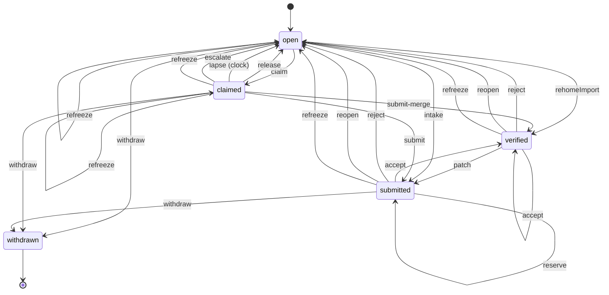

# The item lifecycle

Generated from src/machine.js by `pullboard lifecycle`. Do not edit it by hand: change the declaration, then run `node bin/update-docs.js` to refresh all generated documents.

An item starts open. Its final states, withdrawn, cannot be left. Every move into a guarded state passes the same guards, whatever command gets there. The board file refuses any move not declared here.

## Frozen check policy

The coordinator may set `check.install` and `check.timeout` in committed `pullboard.json`; the defaults are no install and `5m`. Accept runs the configured install and the frozen item check in a private clone under one timeout; a configured `landing.timeout` replaces `check.timeout` as that budget, so a long check reports its real result (#1760). It reuses the verifier’s npm cache if present. Installs that download conflict with P2 (offline); configure an offline install or cache the packages.

Private commands drain output through pipes, keeping a bounded 8 MiB capture of its beginning and end. Failed or unverified checks stream the full log through secret scanning into an owner-readable artifact; lines over 64 KiB of UTF-8 are replaced with a safe-scan marker. Output beyond the cap does not fail a successful command; dependency files and build artifacts have no capture limit. A timeout kills the command's process group. An unverified check names how to restore and retry; a failing one names rejection or builder rework.

## States

| State | Means | Fields it needs |
| --- | --- | --- |
| open | waiting for a builder; claimable once what it waits on is verified | none |
| claimed | an agent holds it under a lease, its criterion frozen | item_owner, item_lease_until, item_frozen_digest |
| submitted | a native build gated green, or an intaken outside commit awaiting sandbox verification, at a pinned commit | item_built_by, item_commit, item_frozen_digest |
| verified | another agent accepted it at the submitted commit, its canonically recorded trunk-only merge, or the item carries an attributed source-board acceptance | item_verified_by, item_commit |
| withdrawn (final) | nobody should build it; the reason stays on it | item_withdrawn_reason |

## Moves

Each move checks its guards in this order and refuses with the first that fails; result-path refusals are listed separately.

| Move | From | To | Who | Guards, in order; result refusals |
| --- | --- | --- | --- | --- |
| patch-claimed | claimed | claimed | coordinator | joined (NOT_JOINED or POLICY_SNAPSHOT_STALE or AGENT_REPLACED or SESSION_LEDGER), itemExists (NO_ITEM or ITEM_MOVED), inState (ITEM_PATCH_STATE), coordinatorOnly (COORDINATOR_ONLY), notMerged (ALREADY_MERGED) |
| patch | submitted, verified | submitted | coordinator | joined (NOT_JOINED or POLICY_SNAPSHOT_STALE or AGENT_REPLACED or SESSION_LEDGER), itemExists (NO_ITEM or ITEM_MOVED), inState (ITEM_PATCH_STATE), coordinatorOnly (COORDINATOR_ONLY), notMerged (ALREADY_MERGED) |
| rehomeImport | open | verified | agent | joined (NOT_JOINED or POLICY_SNAPSHOT_STALE or AGENT_REPLACED or SESSION_LEDGER), itemExists (NO_ITEM or ITEM_MOVED), inState (REHOME_VERDICT), sourceAcceptance (REHOME_VERDICT), atSubmittedCommit (NOT_AT_COMMIT or OUTSIDE_LANE or NO_POLICY or BAD_CONFIG or GIT_GRAFTS), notBuilder (SELF_VERIFY or STRICT_REVIEW_TOUCHED or BAD_REVIEW_POLICY or ITEM_PATCH_FORMAT or ITEM_PATCH or VERIFIER_STANDING or SELF_SESSION_VERIFY), criterionUnchanged (CRITERIA_CHANGED or ITEM_PATCH_CHANGED or ITEM_PATCH_SOURCE or ITEM_PATCH or ITEM_PATCH_AUTHOR), proofNoted (PROOF_REQUIRED) |
| intake | open | submitted | agent, coordinator | joined (NOT_JOINED or POLICY_SNAPSHOT_STALE or AGENT_REPLACED or SESSION_LEDGER), itemExists (NO_ITEM or ITEM_MOVED), inState (NOT_CLAIMABLE), outsideSubmission (OUTSIDE_SOURCE) |
| claim | open, claimed | claimed | agent, coordinator | joined (NOT_JOINED or POLICY_SNAPSHOT_STALE or AGENT_REPLACED or SESSION_LEDGER), itemExists (NO_ITEM or ITEM_MOVED), inState (NOT_CLAIMABLE), checkProvesSomething (CRITERION_PROVES_NOTHING), barReady (BAR_NOT_READY), itemNotHeld (ITEM_HELD), inLane (WRONG_LANE or OUTSIDE_NATIVE_BUILD), routeAllows (ROUTE or DIAGNOSIS_REQUIRED), buildScopeFits (ITEM_BUILD_BUDGET or BAD_BUILD_BUDGET), dependenciesVerified (BLOCKED), notHeldByAnother (HELD), builderFirstRefusal (REOPEN_HELD_FOR_BUILDER), correctionRefrozen (PENDING_REFREEZE), laneOpen (LANE_HELD), lineCapacity (LINE_WIP_LIMIT or LINE_SETTING_RANGE), oneLiveClaim (ONE_CLAIM), rowsInForce (UNKNOWN_SPEC or A5_GRAMMAR_VERSION or NO_POLICY or BAD_CONFIG or AGENT_APPROVAL_REQUIRED or BAR_NOT_READY), result (SOURCE_ADVANCE_STATE), result (ITEM_PATCH_FORMAT), result (RELAY_MOVE), result (EXIT_CONTINUATION), result (EXIT_USAGE), result (BAD_DEPENDENCIES), result (ITEM_LEASE_LOST), result (ENGINE_VERSION) |
| release | open, claimed | open | agent, coordinator | joined (NOT_JOINED or POLICY_SNAPSHOT_STALE or AGENT_REPLACED or SESSION_LEDGER), itemExists (NO_ITEM or ITEM_MOVED), inState (NOT_YOURS), releaseOwnsWork (NOT_YOURS or RELEASE_REASON or BAD_CONFIG or ENGINE_VERSION), reviewReleaseExplained (NOTE_REQUIRED), result (DIAGNOSIS_WRONG), result (BAD_DEPENDENCIES), result (EXIT_CONTINUATION), result (EXIT_SUMMARY), result (EMPTY_FACT), result (FACT_JUDGEMENT), result (BAD_FACT_ID), result (NO_FACT), result (FACT_INDEX_NOT_READY), result (BAD_FACT_KIND), result (BAR_PARENT_UNKNOWN), result (BAR_SELF_SIGN), result (BAD_FACT_REF), result (RIGOR_PERSON_ONLY), result (B26_PERSON_CHANNEL), result (BAD_CAUSE), result (NO_POLICY), result (A5_GRAMMAR_VERSION) |
| lapse | claimed | open | clock, when its lease runs out | none |
358 more lines withheld to keep this output within 8192 bytes; add --detail for all of it, or --json
next: pullboard next --take
